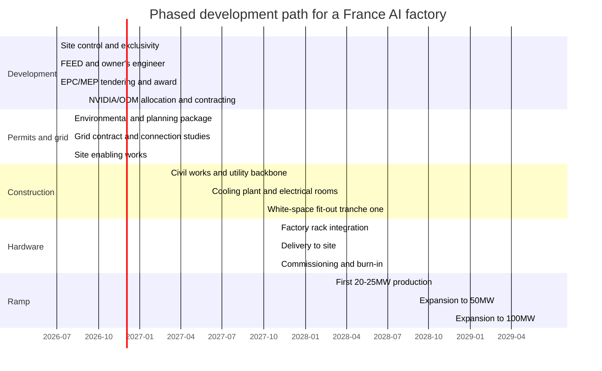
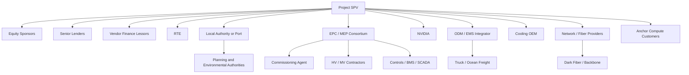

# France 100MW AI Compute Cluster Deep Research Report

## Executive summary

France is one of the strongest locations in Europe for a 100MW-class AI compute cluster because three conditions now overlap: a mostly low-carbon power system with high nuclear output and net electricity exports, a new CRE/RTE “fast-track” process created specifically to accelerate very-large-load connections in the 400kV network, and a growing inventory of brownfield or turnkey industrial sites being actively marketed for large digital and electro-intensive projects. RTE’s 2025 review reports 547.5 TWh of generation in mainland France in 2025; CRE’s fast-track regime explicitly targets 400MW–1GW consumers; and the Élysée’s 2026 Choose France cycle continues to highlight industrial and digital megaprojects. citeturn34search8turn34search1turn34search6

On site selection, the two highest-confidence candidates for a phased 100MW AI factory are **Le Bosquel ZAC** in the Somme and **Dunkerque ZGI** in the Grand Port Maritime de Dunkerque. Le Bosquel has an official RTE fast-track pre-reservation of **1GW**, with local documentation stating **240MW within 24 months**, **1GW within four years**, and a possible extension to **1.4GW** on a site with **33 hectares immediately available** plus **17 hectares of extension**. Dunkerque ZGI has an official fast-track pre-reservation of **700MW**, a published RTE technical concept for a **double underground 400kV connection** to the new **Flandres Maritimes** substation roughly **3 km away**, and a formal schedule pointing to first and second feeds in **September 2029** and **March 2030** respectively. citeturn13view0turn12search9turn11view0turn13view1turn16view2turn22view0

For a deprecated automotive brownfield, the strongest documented case is the **former PSA/Citroën complex in Aulnay-sous-Bois**, where the official Data Hills project is already advancing on a **12.1-hectare** former assembly brownfield at **1 and 47 boulevard André Citroën** with a planned **240MW** data center, a **225kV** transformation post, and RTE connection. More broadly, Aulnay’s former PSA lands represent a **180-hectare** reserve under the wider Val Francilia redevelopment. This makes Aulnay the best documented Peugeot-family brownfield, but it is weaker than Bosquel and Dunkerque for a clean 100MW campus because the site is more urban, more fragmented, and more environmentally sensitive near Parc du Sausset/Natura 2000. citeturn30view0turn23search12turn28view2turn31search2

Technically, the best phased strategy is to start with an **Oberon / NVL72 program** and preserve optionality for a later **Kyber / NVL576 program**. NVIDIA’s official Vera Rubin NVL72 platform is a rack-scale system with **72 Rubin GPUs**, **36 Vera CPUs**, **ConnectX-9 SuperNICs**, **BlueField-4 DPUs**, and **NVLink 6**. For scale-out, NVIDIA points to **Quantum-X800 InfiniBand** or **Spectrum-X Ethernet**; for next-generation power architectures, NVIDIA is moving toward **800VDC**, starting in **2027**, to support **1MW-class** racks and beyond. NVIDIA’s public Kyber disclosures show that Kyber is the 800VDC-oriented rack architecture for the Rubin Ultra era and the foundation for **NVL576**-class scale-up domains. citeturn36view3turn36view4turn36view0turn36view1

For delivery partners, France and Europe already have a plausible build ecosystem. On EPC and MEP, the strongest shortlist is **Bouygues Construction**, **Eiffage Énergie Systèmes**, **Equans**, **VINCI Energies**, **SPIE**, **Mercury**, and **Exyte**. On cooling, the most credible Rubin-ready vendors are **Vertiv**, **Schneider Electric**, **CoolIT**, and **LiquidStack** for direct liquid cooling, with **Submer** and **GRC** as immersion options if the operator is willing to accept a more customized server qualification path. On rack assembly, there are two workable routes: a **Europe-integrated route** using firms such as **Jabil**, **Flex**, or **Sanmina** and then trucking to France; and a **Taiwan-integrated route** using **Foxconn**, **Wiwynn**, **QCT**, or **Inventec**, then shipping to Le Havre/Dunkirk/Antwerp and final-moving inland. citeturn40search3turn39search3turn40search4turn40search10turn40search5turn39search13turn39search5turn41search4turn42search11turn41search2turn43search14turn41search3turn43search17turn44search0turn44search1turn44search2turn45search2turn45search8turn44search3turn45search3

On economics, public pricing is still incomplete, but the broad conclusion is clear: **site and electrical infrastructure costs matter, yet GPU/rack procurement dominates total capital deployed**. A realistic **40MW GB300/NVL72** phase is likely to land in the **€1.6B–€2.3B** total-capex range under current market conditions, depending primarily on rack count, networking topology, and how much of the power/cooling backbone is oversized for the future campus. A phased **100MW path** that starts with NVL72 and adds Kyber later is more likely in the **€4.5B–€7.5B** range. Those numbers are indicative, not quotable vendor offers, because NVIDIA and ODMs are not publishing standardized rack list prices; public third-party reporting places Vera Rubin NVL72 racks around **$5M–$7M**, sometimes higher, and independent Rubin commentary points to **~190–230kW** per NVL72 rack and **~600kW** for Kyber-class racks. citeturn38news42turn38search1turn36view0turn36view1

The financing implication is that a 100MW France AI factory should not be financed as one monolithic first-close unless the sponsor is already hyperscale-grade. The bankable structure is a **tranche model**: close a **20–25MW first phase**, underwrite the site and grid to the eventual 100MW plan, and use a mix of **equity + senior project debt + vendor financing / leases**. In plain terms, Bosquel is the best candidate for **speed**; Dunkerque is the best candidate for **very large-scale power certainty and long-run industrial utilities**; and Aulnay/PSA is best seen as a **brownfield optionality or urban edge-compute/near-Paris precedent**, not the primary 100MW flagship. citeturn12search9turn13view1turn30view0turn31search2

## Energy context and site shortlist

France’s system-level electricity context is attractive for AI infrastructure. RTE’s 2025 annual review reports **547.5 TWh** of mainland generation in 2025 and notes that the conditions are in place to accelerate electrification. France has also re-established itself as a large net exporter of electricity, which matters because investors increasingly look for jurisdictions where adding large demand is politically and systemically defensible. citeturn34search8turn34search4

At the policy and grid-planning level, the key structural enabler is CRE’s approval of RTE’s **fast-track** procedure for very large loads. CRE states that the process is intended to accelerate connection of **400MW to 1GW** consumers at **400kV**, with a target horizon of **2028–2029** for accelerated connection. RTE then applied the process to specific “propitious” sites preselected by the French state, including Le Bosquel and later Dunkerque ZGI. citeturn34search1turn34search9turn13view0turn13view1

### Site comparison

| Site | Location | Current status / control | Land | Grid position | Permitting / environmental posture | 100MW energization view |
|---|---|---|---|---|---|---|
| **Le Bosquel ZAC** | Le Bosquel, Somme, Hauts-de-France; on the A16 corridor between Paris and Lille | ZAC backed by CC2SO; RTE fast-track capacity pre-reserved; CC2SO announced in June 2026 that a SoftBank/Sesterce JV was selected for a **1GW** AI campus | **33 ha** immediately available + **17 ha** extension in the 2025/26 AMI documentation | RTE says the site is close to the **400kV** network; exact target substation is not identified in the public documents reviewed | Existing ZAC planning history; MRAe review on the earlier logistics scheme flagged landscape/heritage issues including the **Chaussée Brunehaut** and requested fuller impact treatment | Highest-confidence fast path among the shortlisted sites: public documents indicate **240MW in 24 months** and **1GW in four years**; a 100MW first campus appears feasible inside that envelope if procurement and permits move promptly |
| **Dunkerque ZGI-D** | Bourbourg / Saint-Georges-sur-l’Aa / Craywick, Grand Port Maritime de Dunkerque | GPMD private-domain industrial land; 2026 AMI for data center/supercomputer use | **21 ha** in current AMI parcel; **10 ha** adjacent area potentially released later; larger **125 ha commercialisable** ZGI platform overall | Official RTE note says direct underground **400kV** connection to **Flandres Maritimes**, about **3 km** away; **700MW** fast-track capacity pre-reserved; potential temporary **30–40MW** from Grand Port source under discussion | Exceptionally strong “turnkey” starting point: port says water-law, protected-species derogation, and archaeology procedures were anticipated; RTE obtained key authorizations for the wider Dunkirk power works in Feb. 2026 | Best long-run power certainty. Official RTE schedule indicates first feed **09/2029**, second feed **03/2030** for the 700MW path; 100MW can be phased into that trajectory, but not as fast as Bosquel |
| **Former PSA/Citroën Aulnay brownfield** | **1 and 47 boulevard André Citroën**, Aulnay-sous-Bois | Former PSA/Citroën assembly brownfield; specific **Data Hills** parcel under project by SNC Data Hills; wider **Val Francilia** redevelopment led by public actors | **12.1 ha** in the Data Hills parcel; wider former PSA reserve reported at **180 ha** | Official project includes a **225kV** transformation post and RTE connection for **240MW**; public documents reviewed do not disclose a Bosquel/Dunkerque-style fast-track reserve for a separate 100MW cluster | More constrained setting: ICPE process, >63kV electrical works, water-law dossier, and sensitivity from nearby **Parc du Sausset** / **Natura 2000** | Viable as precedent and as a brownfield option, but materially less de-risked than Bosquel/Dunkerque for a clean greenfield-like 100MW AI factory |

Sources: Le Bosquel fast-track and local selection data citeturn13view0turn12search9turn11view0turn12search1; Bosquel environmental review citeturn3view1; Dunkerque land, fast-track, and RTE schedule citeturn16view0turn16view2turn13view1turn22view0turn7view2turn8view0; Aulnay/Data Hills brownfield and 240MW project path citeturn30view0turn31search2turn23search12turn28view2

### Le Bosquel ZAC

Le Bosquel is now an official French megasite for AI infrastructure rather than a speculative local idea. RTE’s services portal confirms a **1GW** capacity pre-reservation for the **ZAC du Bosquel** and says these fast-track sites are characterized by large available land positions and proximity to the **400kV** network. CC2SO’s local announcement then confirms that the site was selected for a **1GW AI campus** developed by a SoftBank/Sesterce JV. citeturn13view0turn11view0turn12search1

The most operationally useful Bosquel data point is the 2025/26 AMI communication: it presents the site as **33 hectares immediately available**, **17 hectares** of extension, **240MW available within 24 months**, **1GW within four years**, and possible extension to **1.4GW**. That is the clearest public declaration in France that a non-port inland site can move from a first utility block to a true hyperscale campus in one development logic. citeturn12search9turn21view0

The public permitting picture is promising but not frictionless. The earlier regional environmental authority review on the logistics-park version of the site notes a project area of roughly **43 hectares** and explicitly asks for fuller treatment of landscape and heritage effects, specifically around the **Chaussée Brunehaut**. That does not invalidate the site; it means Bosquel should be treated as **permittable with careful early environmental packaging**, not as a no-risk paper site. citeturn3view1turn21view1

**Bottom line for Le Bosquel:** if the objective is to tell investors there is a French path to the first **20–25MW** and then to **100MW**, Bosquel is the cleanest story today. The main weakness is that the exact public-facing RTE substation target and final technical connection package are not disclosed in the sources reviewed. citeturn13view0turn12search9

### Dunkerque ZGI

Dunkerque is the most powerful site in the shortlist from a pure grid-and-industrial-utilities perspective. RTE confirms that the state has requested a **700MW** fast-track pre-reservation for the **Grande Industrie** zone of the Grand Port Maritime de Dunkerque. The port’s own 2026 AMI then identifies a **21-hectare** parcel in ZGI specifically for **data center and/or supercomputer** use, on the port’s private domain, with a possible adjacency path to an additional **10 hectares** depending on the outcome of a converter-station project. citeturn13view1turn16view0

The RTE technical note is unusually concrete. It says a large power consumer on **ZGI-D** at Bourbourg can be connected directly, underground, to the **Flandres Maritimes** substation, about **3 km as the crow flies**, via a **double 400kV underground** connection. It also states that the structure would securely feed roughly **700MW** and that RTE is exploring a **temporary 30–40MW first block** from the Grand Port source in HTA while the full 400kV path is built. The note’s planning objective is **3.5–4 years**, and the more formal engagement document gives detailed milestones: first feed **September 2029**, second feed **March 2030**. citeturn16view2turn17view5turn22view0

The wider Dunkirk territory is also being massively reinforced for industrial electrification. RTE’s Dunkirk program describes a new **400/225kV** post near Grande-Synthe/Puythouck, links to the **Flandre Maritime** post under construction, and a total additional load outlook of **4,500MW by 2040**. RTE announced in March 2026 that it had obtained key environmental and public-utility authorizations for the Puythouck post and launched the first phase of works. citeturn7view3turn8view0

On permitting, Dunkerque-Port has a genuine advantage over most brownfields. The port says the ZGI platform was developed as a “**clé en main**” industrial site and had already anticipated water-law, protected-species, and preventive archaeology procedures. It also has proximity to potable and industrial water, gas, fiber, and existing port logistics. citeturn7view2turn21view2

**Bottom line for Dunkerque:** for a sponsor that can tolerate a slightly longer first energization path than Bosquel, Dunkerque is arguably the most defensible long-horizon site for a **100MW to multi-hundred-MW AI factory**, especially if the plan includes heat recovery, heavy-duty water systems, import/export logistics, and optional co-location with other industrial processes. citeturn16view2turn7view3

### Former PSA/Citroën brownfield in Aulnay-sous-Bois

The strongest publicly evidenced Peugeot-family brownfield is in Aulnay-sous-Bois. The official environmental review for **Data Hills** states that the project sits on a **12.1-hectare** industrial brownfield at **1 and 47 boulevard André Citroën**, formerly occupied by a **PSA/Citroën automobile assembly activity**, and that it includes a data center, a **high-voltage transformation post**, and a connection to **RTE**. The same document states a planned IT power requirement of **240MW** and a **225kV** post. citeturn30view0

This is important for two reasons. First, it proves that a former PSA brownfield in France is already considered suitable for very large data-center power and land use. Second, it gives investors a concrete parallel permitting path: the Aulnay project is going through **ICPE**, high-voltage, water-law, and construction approvals rather than merely being talked about in concept. Public inquiry notices confirm that the project proceeded through a public inquiry in **May–June 2025**. citeturn31search2turn31search0

The wider former PSA lands are also substantial. Aulnay’s public redevelopment documentation describes the **former PSA terrains** as a **180-hectare** land reserve under the broader **Val Francilia** project, and Paris Terres d’Envol states that Val Francilia is intended to host future-oriented activities, including a digital/AI campus. citeturn23search12turn28view2

The weakness is equally clear: unlike Bosquel and Dunkerque, Aulnay’s public documentation does **not** show a state-backed 400kV fast-track reservation for a 100MW+ AI factory. The environment is also tighter, with the site abutting a sensitive metropolitan context next to Parc du Sausset and Natura 2000 areas. This should therefore be treated as a **credible brownfield option or precedent**, not the first-choice flagship 100MW campus. citeturn30view0turn33view0

## Delivery ecosystem

### Datacenter EPC and construction partners

France and Europe already have enough delivery capacity to build a 100MW AI campus, but the work should be packaged as a **campus EPC + MEP + electrical backbone + commissioning + owner’s engineer** stack rather than handed to one generic contractor. The strongest contenders based on public data-center references and dedicated market positioning are shown below. citeturn40search3turn39search3turn40search4turn40search10turn40search5turn39search13turn39search5

| Vendor | Public capability signal | Relevant public evidence | Best use in a France 100MW program | Confidence |
|---|---|---|---|---|
| **Bouygues Construction** | Dedicated global data-center activity | Says it builds secure, scalable data centers; cites a **50MW** hyperscale project in the Philippines | Prime EPC / shell-and-core / major civil + MEP program integrator | High citeturn40search7turn40search15 |
| **Eiffage Énergie Systèmes / Clévia** | Strong French MEP and cooling execution | Built the then-largest data center in France at Lisses; Data4 Marcoussis cooling partnership; Telehouse Paris HVAC | French MEP lead, cooling plant EPC, retrofit/expansion specialist | High citeturn39search3turn39search6turn39search12 |
| **Equans** | End-to-end data-center design, build, commissioning, prefabrication | Publicly markets complete conception-to-construction delivery and campus coordination | Campus delivery, prefabricated plant blocks, IST commissioning | High citeturn40search4turn40search8turn40search12 |
| **VINCI Energies** | Data-center design, execution, operation via Building Solutions / Axians / Cegelec | Publicly supports specialized solutions for hyperscalers and data professionals | HT/MT/BT, controls, network integration, operations handoff | High citeturn40search10turn40search6 |
| **SPIE** | Dedicated French data-center performance division launched in 2026 | SPIE says it created a dedicated data-center performance department in France | MEP delivery, operations, energy optimization, retrofit | Medium-high citeturn40search5turn40search9 |
| **Mercury** | Pan-European data-center specialist with 200+ projects and Germany offsite manufacturing | Mercury calls itself European leader in data-center solutions and highlights pan-European delivery and offsite manufacturing | Fast-track MEP / CSA / fit-out / offsite skids | High citeturn39search13turn39search16turn39search1 |
| **Exyte** | Large-scale data-center delivery in Europe | Publicly recruiting commercial management roles for Paris and Frankfurt data-center projects | Owner’s engineer / major general contractor / specialist clean-build EPC | Medium-high citeturn39search5turn39search11 |

**Recommendation:** for Bosquel, the strongest structure is a **French civil/EPC lead** plus a **pan-European hyperscale MEP specialist**. For Dunkerque, use a similar pairing but elevate the **port-side utilities and grid-interface consortium**. In practical terms, the most credible tender structure would be something like **Bouygues or Eiffage as campus prime**, **Mercury or Equans as high-density data-hall/MEP co-lead**, and **VINCI Energies / SPIE / Equans** for electrical and controls lots. This is an inference from published capability profiles and project references, not a claim of existing team-ups. citeturn40search3turn39search3turn39search13turn40search4

**Indicative cost range for shell/core + power/cooling backbone:** a practical sponsor model for French high-density AI construction today is **€10M–€18M per delivered IT MW**, excluding the compute racks themselves. The lower end assumes straightforward civil conditions and modularized cooling/electrical rooms; the upper end assumes 400kV intake works, water complexity, aggressive phasing, and large owner-imposed redundancy margins. This range is a modeling assumption for planning, not a published EPC quote.

### Cooling vendors suited to Vera Rubin and Kyber

The public market has already bifurcated between vendors optimized for **direct liquid cooling** at high density and vendors advocating **immersion**. For Rubin-era deployments, the leading path is clearly **direct liquid cooling with warm-water loops and large modular CDUs**, because that matches both NVIDIA’s own AI-factory direction and the ecosystem of Schneider, Vertiv, CoolIT, and LiquidStack. citeturn41search4turn42search11turn41search2turn43search14

| Cooling vendor | Public evidence | Best fit for Oberon NVL72 | Best fit for Kyber NVL576 | Notes |
|---|---|---|---|---|
| **Vertiv** | Says it is delivering converged physical infrastructure for **NVIDIA Vera Rubin DSX** and Omniverse blueprints | Excellent | Excellent | Strong reference-design alignment; likely one of the best choices for standardized Rubin halls. citeturn41search4turn41search8 |
| **Schneider Electric** | Says it has liquid-cooling solutions for **>400kW** racks and co-develops NVIDIA reference designs and modular AI pods | Excellent | Excellent | Particularly strong where you want integrated electrical + control + prefab room strategy. citeturn42search0turn42search11turn42search8turn42search6 |
| **CoolIT Systems** | Public NVIDIA co-innovation pages for cold plates and CDUs | Excellent | Good | Best used at server/rack liquid-loop layer, often behind an EPC or OEM. citeturn41search2turn41search10turn41search14 |
| **LiquidStack** | Publicly markets modular CDUs up to **14MW** and says its GigaModular platform is designed for **NVIDIA Vera Rubin specifications** | Good | Excellent | Particularly attractive for very-large centralized DLC blocks and wet utility plants. citeturn43search14turn43search18turn43search6 |
| **Submer** | Immersion specialist with industrialized SmartPod products | Medium | Medium | Valuable for custom “extreme density / special use” halls, but less aligned with standard NVIDIA rack roadmaps. citeturn41search3turn41search15 |
| **GRC** | Immersion specialist focused on AI/ML and efficiency | Medium | Medium | Best as an alternative workstream if the sponsor wants differentiated immersion economics. citeturn43search17turn43search9 |

ADEME’s 2025 cooling study underlines why this matters. It frames data-center cooling as a major optimization lever, with emphasis on the technology choice and heat-reuse potential. That makes **warm-water direct liquid cooling** particularly compelling in Dunkerque and Bosquel, where low-grade heat reuse can help the investor narrative and possibly local acceptability. citeturn34search3turn34search7turn34search15

**Recommendation:** use **direct liquid cooling** as the default for both Oberon and Kyber. Keep **immersion** only as a deliberate special-case branch, not as the base plan, unless your OEM/ODM and NVIDIA qualification path explicitly support it.

### Rack assembly routes and logistics

There are two credible assembly/logistics models.

**Option A: European rack integration and trucking to France.**  
This route uses European or near-Europe system integrators to receive compute trays, power/cooling subassemblies, networking, and enclosures, then performs full L6–L10 rack integration, burn-in, packaging, and just-in-time truck delivery into France. The best publicly evidenced candidates are **Jabil**, **Flex**, and **Sanmina**, all of which publicize large-scale rack integration for cloud/data-center infrastructure. citeturn44search0turn44search1turn44search2turn44search12turn44search13turn44search14

The principal benefits are lower logistics risk, faster replacement cycles, easier customs handling, and less port dependence. The main disadvantage is that the most advanced Rubin systems may still originate from Taiwan-centric ODM pipelines, so Europe may become a **final integration / localization / staging node** rather than the original manufacturing node for every component. NVIDIA’s own message that Rubin is ramping with Taiwan’s top server makers reinforces that point. citeturn36view3turn45search2turn45search8turn44search3

**Option B: Taiwan ODM assembly and containerized shipment to France.**  
This route aligns most directly with the Rubin ecosystem. Public sources show **Foxconn**, **Wiwynn**, **QCT**, and **Inventec** all actively marketing or exhibiting **Vera Rubin NVL72** infrastructure in 2026. QCT explicitly says its AI POD supports Vera Rubin NVL72, Foxconn says it is showing full-system Vera Rubin racks, Wiwynn says it is a Tier-1 strategic collaborator in Rubin commercialization, and Inventec describes a fully liquid-cooled Rubin NVL72 platform. citeturn45search2turn45search8turn44search3turn45search3

This Taiwan-first route offers the strongest access to first-wave Rubin volume, but it adds maritime transit, insurance, customs, and larger staging requirements in France. Freightos’ indices and transit tools are useful planning references for this route, and the EU’s TARIC system is the official source to confirm the correct customs classification and duty profile for each exact equipment line. OCP’s 2026 guidance is also useful because it specifically addresses shipping and storage practices for **liquid-cooled racks and servers**. citeturn46search0turn46search6turn46search1turn46search5turn46search11

**Practical planning assumptions for logistics**  
These are **model assumptions**, not tariff quotes or carrier offers:

| Item | Europe truck route | Taiwan container route |
|---|---|---|
| Factory integration lead after long-lead parts arrive | ~6–10 weeks | ~4–8 weeks at ODM once allocation is secured |
| Transit to site | ~1–4 days road from Central Europe | ~30–40 days ocean plus terminal/customs buffer |
| Packaging form | Prefer partial rack integration or shock-qualified full rack depending OEM | Usually better as sub-racks / trays / sidecars / networking packs rather than one monolithic shipped rack |
| Per-rack logistics planning allowance | ~€8k–€20k for high-value liquid-cooled AI rack moves | ~€20k–€60k equivalent once containers, handling, insurance, and inland haulage are included |
| Customs | Minimal internal-EU frictions once assembled in EU | Must classify each bill of material line in TARIC; product-specific duty/VAT treatment must be confirmed in the real shipment plan |

Those assumptions are directionally consistent with public freight and customs references but must be replaced by actual forwarder quotes during FEED and procurement. citeturn46search0turn46search1turn46search4turn46search11

### Power and network cabling contractors

The on-site grid and distribution stack should be split into four packages: **RTE interface / 400kV**, **owner substation and MV distribution**, **white-space power and busway**, and **fiber/backbone/network integration**. Publicly visible candidates with the right capability profile include **Equans**, **Eiffage Énergie Systèmes**, **VINCI Energies** brands such as Cegelec/Axians, and **SPIE**. RTE’s own ecosystem page also points to **Arteria**, its fiber subsidiary, as a natural dark-fiber counterpart for long-haul backbone routes. citeturn40search8turn39search3turn40search10turn40search6turn40search5turn8view0

**Modeled cost placeholders** for planning in France are as follows:

- **Grid interface / owner substation / MV backbone:** roughly **€1.5M–€4M per delivered MW** depending on whether the 400kV intake, main transformers, and redundancy strategy are inside the owner budget or mostly inside the RTE connection contribution.
- **White-space busway / RPP / PDUs / cable trays:** roughly **€0.8M–€1.8M per MW**.
- **Campus network + meet-me rooms + dark-fiber and backbone integration:** roughly **€10M–€40M** for a serious 100MW AI campus, depending on external connectivity diversity and whether InfiniBand or Ethernet fabrics are owner-furnished.

These are modeling allowances only. For Dunkerque, the strongest public hard number is RTE’s indication that choosing **≤500MW** instead of 700MW could reduce the connection cost by around **€17M**, which is useful mainly as a sign that the connection economics move materially with the chosen power block. citeturn18view2turn20view0

## Technical architecture and tranche design

### Oberon option

The **Oberon** option in this report is the practical **Vera Rubin NVL72** building block. NVIDIA’s official Rubin page says the platform unifies **72 Rubin GPUs** and **36 Vera CPUs**, with **ConnectX-9 SuperNICs**, **BlueField-4 DPUs**, and **NVLink 6**. NVIDIA also says the rack is supported by **over 80 MGX ecosystem partners** and that Rubin is in full production with Taiwan server makers and global supply-chain partners manufacturing and shipping systems at scale. citeturn36view3

At the performance layer, NVIDIA positions Vera Rubin NVL72 as a large advance in inference efficiency and throughput per megawatt, including a claimed **10x lower cost per million tokens** versus GB200 NVL72 for certain deep-reasoning use cases and **up to 10x more tokens per megawatt** in the same power footprint. Those are NVIDIA claims on preliminary/subject-to-change figures, but they are exactly why NVL72 is the right first tranche for an AI-factory thesis. citeturn36view3

Public rack-power numbers for Rubin NVL72 are still not formally published on NVIDIA’s product page, so for planning it is safer to treat the power envelope as **preliminary**. A recent industry engineering note from ModulEdge places **VR200 NVL72** at roughly **190–230kW per rack**, while NVIDIA’s own 800VDC material frames the transition as necessary because the industry is moving toward **1MW IT racks and beyond starting in 2027**. citeturn38search1turn36view0

For site planning, a robust **Oberon hall** should therefore assume:

- **Rack power:** planning basis **210kW average**, with design margin toward the high end.
- **Cooling:** direct-to-chip liquid cooling with warm-water loops and centralized or room-level CDUs.
- **Scale-out fabric:** **Quantum-X800 InfiniBand** for model training-heavy campuses or **Spectrum-X Ethernet** for mixed enterprise/cloud/agentic inference strategy. NVIDIA officially supports both on Rubin. citeturn36view3

A **20MW tranche** at a 210kW rack-planning basis implies roughly **95 NVL72 racks**. A **25MW tranche** implies roughly **119 racks**. That is a manageable first phase operationally: large enough to be strategically meaningful, small enough to absorb supply-chain variability and to finance without needing a hyperscaler balance sheet. This rack-count math is a model calculation based on the power assumptions above.

### Kyber option

The **Kyber** option in this report is the **NVL576-class** scale-up path for the Rubin Ultra / post-Oberon stage. NVIDIA’s public 800VDC and Rubin POD material shows that Kyber is the architecture designed around **800VDC** and massive scale-up domains, and that it underpins the next step toward **NVL576**. NVIDIA’s blog also states that Kyber will first appear with Vera Rubin Ultra as a standalone **NVL144** system, with three NVIDIA scale-up domain options: **NVL72**, **NVL144**, and the flagship **NVL576**. citeturn36view1turn36view4

In technical terms, Kyber matters because NVIDIA says power is distributed at high voltage directly to each compute node and then stepped down locally through a high-ratio converter; this single-stage approach is claimed to be more efficient and to occupy **26% less area** than the traditional multi-stage method. NVIDIA’s 800VDC article also says this transition can improve end-to-end efficiency by **up to 5%**, reduce maintenance costs by **up to 70%**, and cut TCO by **up to 30%**. citeturn36view1turn36view0

Again, public rack-power data is still emerging. Third-party engineering commentary in the Rubin ecosystem points to **~600kW** for Kyber-class racks, and NVIDIA itself explicitly describes the 800VDC target as supporting **1MW-class racks and beyond** from 2027 onward. The right conclusion is not that every Kyber hall will be 1MW/rack, but that **a Kyber-ready site must be designed as if 600kW to 1MW rack bands are possible during the asset life**. citeturn38search1turn36view0

For site planning, a robust **Kyber hall** should therefore assume:

- **Rack power:** planning basis **600kW** now, with civil and electrical reservations for future **1MW-class** variants.
- **Electrical architecture:** 800VDC-ready row or hall distribution.
- **Cooling:** very-high-capacity direct liquid cooling with centralized CDUs and simplified, serviceable rack-side wet interfaces.
- **Use case:** flagship scale-up training/inference domains after the first Oberon rooms have validated the campus, utilities, and commercial demand.

On a **25MW** planning block, a 600kW Kyber assumption implies roughly **42 racks**. That is operationally attractive because the rack count is lower, but each rack becomes more infrastructure-intensive. The business implication is that Kyber is a **second-wave efficiency and density play**, not the best first tranche unless the sponsor already controls the NVIDIA allocation, the 800VDC supply chain, and a top-tier commissioning team.

### What to build first

The safest design philosophy is:

1. **Build the campus electrical and civil backbone so it can host both Oberon and Kyber.**
2. **Install Oberon first** in 20–25MW increments because the supply chain is broader and the commissioning risk is materially lower.
3. **Introduce Kyber** as a second-wave hall or second campus block once the operator has validated actual workload mix, contract tenure, and water/power performance.

That approach is consistent with NVIDIA’s own staged power roadmap, where 800VDC begins to matter from 2027 onward rather than needing to be forced into the very first phase if it adds timing risk. citeturn36view0turn36view1

### Sourcing timelines and integration risk

NVIDIA states Rubin is in full production and highlights active manufacturing by Taiwan server makers and the wider supply chain. QCT, Foxconn, Wiwynn, and Inventec all publicly displayed or discussed Rubin systems in 2026. That is a meaningful positive signal, but it does **not** mean near-zero lead times for first-wave programs. citeturn36view3turn45search2turn45search8turn44search3turn45search3

A prudent sponsor model should assume:

- **First Oberon tranche:** **9–15 months** from allocation/PO to fully installed production, depending primarily on NVIDIA allocation, ODM slotting, and liquid-cooling plant readiness.
- **Follow-on Oberon tranches:** **6–10 months**.
- **First Kyber tranche:** **12–18 months**, because 800VDC interfaces, rack-side conversion, and field commissioning risk are all higher.
- **Site assembly and burn-in:** **8–12 weeks** for a 20–25MW tranche once all hardware is on site.

These are **modeled schedule ranges**, not vendor SLAs.

The principal integration risks are not “can a GPU rack be assembled?” but rather:

- synchronization of **NVIDIA allocation** with **CDU/power-shelf availability**,
- software and fabric readiness for **very large scale-out domains**,
- acceptance testing for **liquid-cooled transport and storage**,
- and for Kyber, **800VDC compliance, serviceability, and field support maturity**. citeturn46search11turn36view0turn36view1

## Economics and financing

### Capital expenditure model

Public rack list prices are not published in a standard way by NVIDIA or the ODMs. The most usable public market indicator is third-party reporting that places **Vera Rubin NVL72** racks broadly in the **$5M–$7M** range and sometimes above that depending on configuration. Combined with public power commentary and current high-density build costs, it is reasonable to treat the following as **planning ranges**, not executable vendor quotes. citeturn38news42turn38search1

#### Modeled capex ranges

| Program | Planning basis | Total capex range | Commentary |
|---|---|---:|---|
| **40MW GB300 NVL72 campus** | ~282 GB300 racks at **142kW** each; AI-ready facility backbone; scale-out fabric; commissioning | **€1.6B–€2.3B** | Lower end assumes favorable hardware allocation and limited oversizing; upper end assumes stronger redundancy, more network/storage, and campus oversizing for future expansion |
| **20MW Oberon tranche** | ~95 Rubin NVL72 racks at ~210kW average planning basis | **€0.85B–€1.15B** | Best “first close” format for most sponsors |
| **25MW Oberon tranche** | ~119 Rubin NVL72 racks | **€1.00B–€1.35B** | Appropriate if the site and off-take are already highly de-risked |
| **25MW Kyber tranche** | ~42 Kyber racks at ~600kW planning basis | **€1.10B–€1.45B** | Fewer racks, but higher per-rack and infrastructure intensity |
| **100MW campus path** | Mixed path: early NVL72 halls followed by Kyber halls | **€4.5B–€7.5B** | Best thought of as a multi-close program, not one initial all-in financing |

The most important funding lesson is that **the compute kit dominates**. The civil/electrical/cooling campus is expensive, but the high-value Rubin/Kyber hardware and fabrics are the primary capital sink.

### Operating expenditure and TCO

For planning, use three energy scenarios:

- **Good France baseload case:** **€55/MWh**
- **Base case:** **€70/MWh**
- **Stress case:** **€85/MWh**

These are **modeled assumptions** for delivered industrial power, not tariff offers or PPA quotes. For PUE, model:

- **Best-in-class DLC and strong water strategy:** **1.10**
- **Base liquid-cooled campus:** **1.15–1.18**
- **Operationally conservative / mixed halls:** **1.22–1.25**

Using those assumptions:

- A **40MW IT** campus at **95% utilization** and **PUE 1.15** consumes about **383 GWh/year**, implying roughly **€21M/yr**, **€27M/yr**, or **€33M/yr** of electricity at the three energy-price cases.
- A **100MW IT** campus at **95% utilization** and **PUE 1.15** consumes about **957 GWh/year**, implying roughly **€53M/yr**, **€67M/yr**, or **€81M/yr** of electricity.  

These are model calculations from the utilization, PUE, and price assumptions above.

A practical annual non-energy operating budget for a 40MW AI campus is typically in the **€20M–€45M** band before major hardware refresh, including staff, facility maintenance, third-party service, spares, software/platform operations, and security. For a 100MW campus, **€45M–€95M/yr** is a more useful planning band. The upper end becomes relevant if vendor support, spare pools, and enhanced operational control are heavily internalized. These are modeled ranges.

#### Indicative TCO summary

| Program | 5-year TCO | 10-year TCO | Main drivers |
|---|---:|---:|---|
| **40MW GB300 NVL72** | **€2.0B–€2.8B** | **€2.9B–€4.1B** | Initial capex, power, support contracts, year-5 compute refresh decision |
| **20MW Oberon tranche** | **€1.0B–€1.4B** | **€1.5B–€2.2B** | Same as above, but better flexibility on refresh timing |
| **100MW phased NVL72→Kyber campus** | **€5.4B–€8.4B** | **€7.8B–€11.5B** | Staging sequence, energy price, refresh cadence, utilization |

The **5-year** horizon is the more decision-useful one for investors in this market, because a year-5/6 hardware refresh or repower decision typically dominates long-range economics more than the precise year-10 O&M line.

### Financing structures

A 100MW AI factory can be financed, but not with one generic data-center template. Three structures are the most credible.

**Tranche project finance structure.**  
Best for Bosquel or Dunkerque if a real campus customer or long-term compute demand is visible. Typical structure: **35–45% equity**, **40–55% senior debt**, **10–20% vendor finance / leases**. This structure works best when the site and grid are de-risked first and the hardware is funded tranche by tranche.

**Corporate / holdco with asset-level debt.**  
Best when the sponsor expects rapid scaling and cannot wait for every drawdown to be fully project-finance bankable. More flexible, but usually more expensive capital unless the sponsor is already well-rated.

**Anchor-tenant backed structured lease or capacity prepay.**  
Best when the operator can secure long-duration GPU capacity commitments from cloud, sovereign-AI, or enterprise buyers. This is the cleanest way to support debt sizing for Rubin/Kyber hardware, which otherwise depreciates faster than the real estate and utility plant.

**Modeled debt ranges** for planning, not live loan quotes:

- **Senior secured debt:** **5.0%–7.5%**
- **Mezzanine / junior capital:** **9%–13%**
- **Vendor financing / lease lines:** **6%–9%**
- **Green / sustainability-linked bond format:** potentially **4.5%–6.5%** for strong sponsors with credible heat-reuse and low-carbon sourcing narratives

#### Example capital stacks

| Case | Capex | Equity | Senior debt | Vendor finance / lease | Comment |
|---|---:|---:|---:|---:|---|
| **20MW first tranche** | €1.0B | €400M | €450M | €150M | Most balanced starter structure |
| **25MW first tranche** | €1.25B | €500M | €560M | €190M | Better if site works and power backbone are front-loaded |
| **100MW full path** | €5.5B | €1.9B | €2.8B | €0.8B | Realistic only as a phased multi-draw plan |

#### Annual debt-service planning examples

Using simple amortizing assumptions:

- **€450M senior debt, 10 years, 6.0%:** annual debt service about **€61M**
- **€150M vendor line, 5 years, 7.5%:** annual debt service about **€37M**
- **€2.8B senior debt, 12 years, 5.75%:** annual debt service about **€320M–€330M**  

These are modeled annual-payment estimates.

### Sensitivities that matter most

For investors, the three biggest sensitivities are **utilization**, **rack allocation timing**, and **energy price**.

- At **40MW IT**, every **€10/MWh** change in delivered energy price moves annual power cost by roughly **€3.8M** at **PUE 1.15** and **95% utilization**.
- At **100MW IT**, the same **€10/MWh** swing moves annual power cost by roughly **€9.6M**.
- A **10 percentage-point utilization gap** is commercially far more important than a few basis points of PUE, because it changes both revenue and the procurement pace for later tranches.

This is exactly why the tranche model is stronger than an all-at-once build.

## Site-specific execution plans

### Le Bosquel ZAC execution plan

Le Bosquel is the only site in the shortlist where public documents already line up around a **very fast first power block**. The recommended Bosquel path is:

- **Phase A:** acquire/control the first **33ha** plot package and complete FEED, environmental packaging, and RTE interface design around a **20–25MW Oberon tranche**.
- **Phase B:** build one or two NVL72 halls, initial substation/MV backbone, warm-water liquid cooling, and enough shell-space and external plant for later doubling.
- **Phase C:** expand to **50MW**, then **100MW**, while preserving the full campus plot and grid rights for the longer road to **240MW+** and eventually **1GW**. citeturn12search9turn11view0turn13view0

A realistic Bosquel schedule from a true final investment decision is roughly:

- **0–6 months:** FEED, permit packaging, OEM/ODM reservation, EPC tender
- **6–18 months:** civil works, utility backbone, cooling plant, first equipment deliveries
- **18–24 months:** energization and first production for tranche one
- **24–36 months:** tranche-two expansion toward **50MW–100MW**

That schedule is an inference from the published **240MW in 24 months** positioning and the formal 1GW fast-track reserve. Bosquel’s key risk is not power scarcity but **permit/package execution discipline**. citeturn12search9turn13view0

### Dunkerque ZGI execution plan

Dunkerque should be run as a **campus utility platform**, not just a data-center building program. The recommended path is:

- **Phase A:** secure the **21ha** AMI parcel and formally align the campus masterplan with RTE’s **700MW** fast-track framework.
- **Phase B:** decide whether to pursue the provisional **30–40MW** HTA starter supply while the 400kV route is being built.
- **Phase C:** install first Oberon halls and water/heat-recovery systems sized to the port-industrial environment.
- **Phase D:** transition to the full 400kV-fed campus as the Flandres Maritimes / Puythouck works deliver the long-run connection. citeturn16view0turn16view2turn22view0

Dunkerque’s advantage is that the site is already integrated into a much larger industrial-electrification wave. Its drawback is that the official RTE schedule is explicit: first and second feeds for the large fast-track path are **2029–2030**, not 2027. If the sponsor’s business case can monetize a modest initial block and then ramp hard into the 400kV path, Dunkerque is extremely strong. If the thesis requires a very fast first 100MW, Bosquel remains ahead. citeturn22view0turn17view5turn8view0

### Former PSA/Citroën brownfield execution plan

For Aulnay or another former automotive urban-edge brownfield, the right strategy is different. The site should be framed as a **brownfield, near-Paris, datacenter-proven redevelopment** rather than as the primary 100MW sovereign-AI flagship. The evidence from Data Hills shows a **240MW** path on former PSA land, but it also shows the likely complexity: ICPE, urban consultation, environmental review, high-voltage works, and a metropolitan planning context. citeturn30view0turn31search2

The most credible way to use Aulnay in an investor narrative is as follows:

- as a **proof point** that ex-automotive French brownfields are datacenter-capable,
- as a **secondary option** for a Paris-adjacent training/inference node,
- or as a **special-purpose campus** focused on lower-latency inference, customer proximity, or national-sovereignty workloads.

For a fresh 100MW campus, the public evidence is simply not as strong as Bosquel or Dunkerque.

### Timeline visualization

The diagram above is a synthesized planning schedule rather than a source document. It is anchored to the Bosquel and Dunkerque public connection windows and to the procurement realities implied by NVIDIA’s Rubin ramp and the RTE fast-track program. citeturn12search9turn22view0turn36view3

### Stakeholder map

In France, the highest-friction interfaces are usually not between the sponsor and the GPU vendor, but between the sponsor, **RTE**, the **local land authority** or **port**, and the **permitting/environmental authorities**. That is why structured governance matters as much as technology selection. citeturn13view0turn13view1turn8view0

## Investor one-pager

**France can support a 100MW AI factory, and it offers more than one credible path.** The case rests on a favorable electricity system, a state-backed large-load connection process, and a short list of specific industrial sites already being advanced for digital or electro-intensive use. In 2025 France generated **547.5 TWh** of electricity, and CRE/RTE created a **fast-track** framework specifically to accelerate **400MW–1GW** loads on the 400kV grid. citeturn34search8turn34search1

**There are at least two bankable flagship sites.**  
**Le Bosquel** is the speed play: **33 ha** ready, **17 ha** extension, **240MW in 24 months**, **1GW in four years**, and an official **1GW RTE fast-track reservation**.  
**Dunkerque ZGI** is the scale-and-utilities play: **700MW** fast-track reservation, a published **400kV** connection concept, strong industrial-water/fiber/logistics conditions, and a long-run platform for a much larger campus. citeturn12search9turn13view0turn16view2turn13view1

**A phased build is the right financing strategy.** Rather than raising one giant first close, the project should begin with a **20–25MW NVL72 tranche**, build the campus backbone for future expansion, and then add later tranches to reach **50MW** and **100MW**. This lowers execution risk, improves debtability, and matches the actual cadence of grid works, procurement, and customer uptake. Kyber-class 800VDC halls should be the **second-wave density upgrade**, not the day-one dependency. citeturn36view3turn36view0turn36view1

**The supply chain is real.** NVIDIA says Rubin is already in full production, with Taiwan server makers shipping at scale, and the European delivery stack already exists across Bouygues, Eiffage, Equans, VINCI Energies, SPIE, Mercury, and Exyte. Cooling and electrical ecosystems are converging around direct liquid cooling and, from 2027 onward, **800VDC** for very-high-density halls. citeturn36view3turn40search3turn39search3turn40search4turn40search10turn40search5turn39search13turn39search5turn41search4turn42search11

**What investors should take away:** France is not a single-site bet. It is a **portfolio of pathways**. Bosquel offers speed, Dunkerque offers long-run depth, and former automotive brownfields such as Aulnay prove that French industrial redevelopment can host very large digital loads. The capital strategy should follow the same logic: **tranche the build, tranche the financing, preserve the 100MW option from day one.** citeturn11view0turn16view0turn30view0

## Open questions and limitations

Some items remain incomplete in public sources and should be verified in the next diligence phase rather than guessed now. The **exact target RTE substation** for Bosquel is not named in the public sources reviewed, even though the site’s 400kV proximity and 1GW fast-track status are explicit. Parcel-level **current ownership** across the wider former PSA lands in Aulnay is also not fully transparent in the public documents reviewed; the best public evidence is the Data Hills project on a former PSA brownfield and the broader Val Francilia redevelopment narrative. citeturn13view0turn30view0turn23search12

Public pricing for **Rubin and Kyber hardware** remains incomplete and inconsistent. NVIDIA is publishing architecture, ecosystem, and performance direction, but not standardized submit-to-procure price cards. The rack pricing and power-density assumptions in this report are therefore **planning assumptions informed by public secondary reporting**, not binding commercial references. citeturn36view3turn38news42turn38search1

The same caution applies to **delivered power price**, **land price**, **water charges**, and **debt pricing**. Where no authoritative public source was available in the research completed here, the report explicitly uses ranges and labels them as modeled assumptions. Those items should be replaced in the next stage with actual LOIs, utility offers, lender feedback, freight quotes, and industrial appraisals.