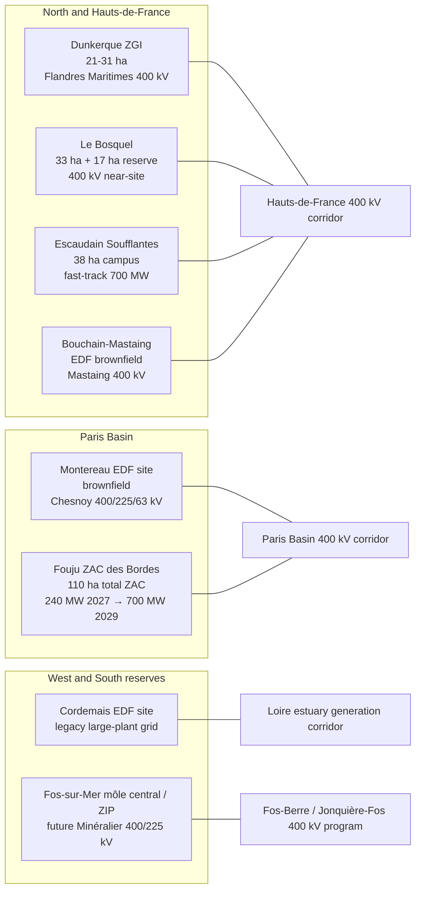
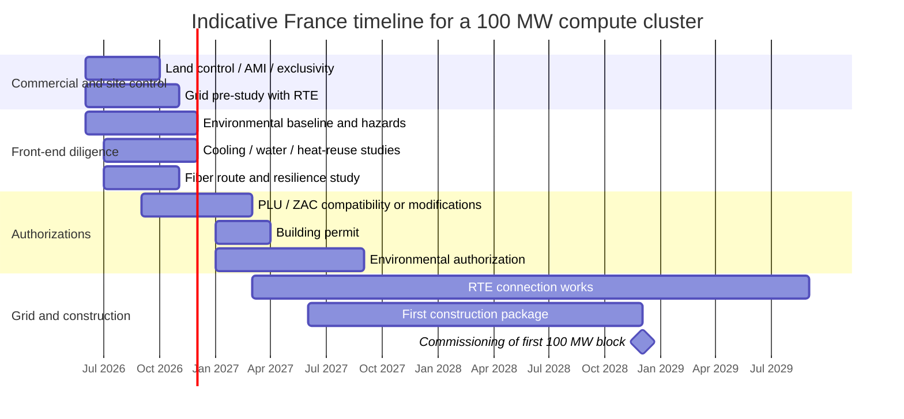

# France Candidate Locations for a 100 MW Compute Cluster

## Executive summary

France is one of the few European markets that is now explicitly trying to steer very large digital loads toward pre-screened industrial sites with strong transmission access. Since 2025, RTE and the French state have created a **“fast-track”** framework for very-high-power consumption sites, focused on land that is already industrial in planning documents, close to the **400 kV** network, and large enough to host hyperscale development. The CRE approved this accelerated route for projects in roughly the **400 MW to 1 GW** range, with connection horizons around **2028–2029** and, in RTE’s own site-label materials, generally **under four years** from acceptance of the grid engagement. That matters for a **100 MW** cluster because the best French sites for a 100 MW project are often **over-provisioned**: they are not sized for 100 MW alone, but they are exactly the places where a 100 MW first phase can be delivered with the lowest structural grid risk. citeturn29view1turn29view0turn37view0

On the evidence available publicly, the strongest **independently actionable** options today are: **Dunkerque ZGI** (best published grid certainty and industrial utilities), **Le Bosquel** (best open greenfield/industrial-campus balance), and **Bouchain–Mastaing** (best EDF-controlled brownfield with a known 400 kV transmission tie, though public spare-capacity data are not published). The technically excellent but less independently available sites are **Montereau**, **Fouju**, and **Escaudain**, because all three are already tied to selected or announced developers/projects. For geographic diversification beyond northern France and the Paris Basin, **Fos-sur-Mer** is the strongest long-term southern reserve candidate, while **Cordemais** is a western reserve candidate but looks materially less available because EDF has already announced another industrial reuse on site. citeturn17view1turn17view2turn42view0turn13view4turn32view0turn13view2turn35view2turn40view2turn19search2turn10search11

The core conclusion is straightforward: if the goal is a **standalone new 100 MW campus controlled by a new entrant**, the most credible first calls should be **Dunkerque**, **Le Bosquel**, and **Bouchain**. If the goal is instead to secure **100 MW as a first block inside a larger French AI / hyperscale development**, then **Montereau**, **Fouju**, and **Escaudain** become highly attractive — but through partnership, tenancy, or structured entry rather than simple greenfield acquisition. citeturn17view1turn42view0turn13view4turn13view2turn37view2turn40view2

## What a 100 MW French site must satisfy

The French public framework is unusually explicit about what makes a site “propitious” for very large digital loads: industrial land already recognized in planning documents, **several dozen hectares**, and proximity to an RTE **400 kV** node or line so that large power can be delivered rapidly. The government’s 2025 data-center siting guide also emphasizes grid connection, environmental fit, digital connectivity, and the local project’s economic and territorial integration. citeturn29view0turn37view0turn1search0turn4view2

For a practical **100 MW** screen, I would use the following standard:

| Criterion | Practical requirement for a 100 MW compute cluster |
|---|---|
| **Land area** | Prefer **15–25 hectares gross** for a single-phase 100 MW campus, and **20–40 hectares** if the masterplan includes a major on-site transformation yard, large stormwater basins, heat-reuse interfaces, security/setback buffers, and future expansion. This threshold is an **inference** from the published densities of French hyperscale-ready sites: Dunkerque’s 21 ha minimum is offered for 400 MW, Le Bosquel publishes 33 ha immediate for a 240 MW first phase, Escaudain’s public project is 38 ha, and Fouju’s ZAC provides 40 ha on the commune and 110 ha at full ZAC scale. citeturn17view1turn42view0turn40view2turn34view0 |
| **Grid connection** | Prioritize sites with an **existing or planned 400/225 kV** node within a few kilometers, or a legacy plant connection already tied into transmission. France’s fast-track process is explicitly built around proximity to **400 kV** infrastructure. A 100 MW project can be smaller than the fast-track threshold, but these sites still offer the lowest structural connection risk. citeturn29view0turn29view1turn37view0 |
| **Industrial land / planning status** | Strong preference for brownfield, port-industrial, EDF legacy thermal sites, or ZAC/industrial land already designated in the PLU/PLUi. This materially lowers land-use risk and often shortens environmental review. citeturn1search0turn34view0turn13view0turn13view4 |
| **Cooling and water** | Use **air or hybrid cooling** as the base case unless an industrial/raw-water network is already present and clearly permitted. Public planning should explicitly identify water utility conditions, stormwater handling, and heat-recovery opportunities. France now also applies data-center heat-reuse obligations and efficiency reporting above 1 MW, subject to exceptions where reuse is not technically or economically feasible. citeturn18view3turn24search2turn24search3 |
| **Fiber connectivity** | Require at least **two diverse long-haul routes** and enough land geometry to bring them in separately. Public French site notices often confirm strong regional connectivity but rarely publish exact fiber distances; in practice, a bespoke carrier route survey is still needed. Dunkerque is notable because the port documentation explicitly highlights the region’s East–West and North–South communications position. citeturn18view0 |
| **Environmental constraints** | Screen parcel-by-parcel for **flood risk, coastal submersion, protected species, water-law triggers, contaminated soils, and seismicity** using official tools (notably **Géorisques**) and local permit files. Brownfields can reduce land-take risk but increase remediation complexity. citeturn0search3turn26view4turn32view0 |
| **Population / workforce** | Favor locations within **45–60 minutes** of a meaningful technical labor basin, but not so close to dense housing that noise, traffic, and visual issues dominate. The state guide and local site pages repeatedly frame data-center siting around local employment, training, and territorial integration. citeturn4view2turn13view0turn35view2 |
| **Redundancy / resilience** | Require dual utility corridors where possible, site geometry for N+1/N+N electrical architecture, diverse fiber entries, robust drainage, and realistic generator / battery logistics. At French fast-track sites, assume that the client will build a substantial on-site transformation and resilience architecture even if RTE delivers at 400 kV. citeturn17view1turn17view2 |

The strategic implication is that the French market should be screened in two tiers. First, identify locations that are **power-realistic**. Second, among those, choose sites whose **planning, environmental, and commercial control** are realistic for your deal structure. In this study, several technically excellent sites lose rank not because of the grid, but because they appear effectively spoken for already. citeturn13view2turn35view2turn40view2

## Prioritized shortlist

The table below is ranked for a sponsor seeking a **100 MW first phase** in France. “Independent” means a new entrant appears able to pursue the site directly from the public landowner / AMI process. “Partner-only” means public evidence suggests that the site is already effectively tied to another lead developer, making a direct standalone entry less likely.

| Priority | Site | Location | Owner / commercial status | Land area | Nearest HV node / line | Public power view | Fiber / water | Main constraints and likely timeline | Key sources |
|---|---|---|---|---|---|---|---|---|---|
| **Highest** | **Dunkerque ZGI** | Grand Port Maritime de Dunkerque, Nord | **Grand Port Maritime de Dunkerque**; AMI launched for data center / supercomputer uses | **21 ha firm**, with 25 ha and 31 ha configurations mentioned | **Future Flandres Maritimes 400 kV** post about **3 km** away; wider program also adds **Puythouck 400/225 kV** near Grande-Synthe | Published as **400–700 MW**; RTE says 700 MW can be delivered in about **3.5–4 years** from definitive engagement; temporary supply may be negotiable from an existing port substation | Fiber distance **not publicly specified**; AMI highlights strong regional communications position. Potable and industrial water networks are present; no collective sewer | Best public power certainty in this review. Main issues are AMI competition, coastal/industrial environmental sensitivity, and flood/coastal-resilience due diligence. Administrative complexity is **medium-high**, but better de-risked than most sites because some water-law / species authorizations already exist at port level | citeturn17view1turn17view2turn18view3turn16view1 |
| **Very high** | **Le Bosquel ZAC** | Le Bosquel, Somme | **CC2SO** AMI for hyperscale campus | **33 ha immediate** + **17 ha reserve** | RTE notice says site is close to the **400 kV** grid; procurement notice refers to a **400 kV post planned in the immediate vicinity** | First phase framed around **~240 MW**, scaling to **1 GW**; RTE had already pre-reserved **1 GW** and later extended the reservation window | Fiber distance **not publicly specified**; cooling concept left to bidders | One of the best “open” sites: meaningful land, immediate mobilization, and explicit large-load planning. Main hurdles are agricultural land conversion, environmental acceptance, and dependence on the planned near-site 400 kV works. Complexity **medium-high**; attractive for a 100 MW first block if the sponsor can live inside a larger campus envelope | citeturn42view0turn12search1turn6search11turn41search4 |
| **Very high** | **Bouchain–Mastaing former EDF thermal site** | Bouchain / Mastaing, Nord | **EDF**; CEI launched in April 2026 for a construction lease | **Public land area not specified** in reviewed EDF materials | Known legacy tie to **Mastaing 400 kV** via a **2.4 km** underground 400 kV line built for the Bouchain CCG | **Public spare capacity unspecified**; EDF markets the site as having “strong potential” for rapid high-power connection; active adjacent CCG is **605 MW** | Fiber distance **not publicly specified**; site is near the Escaut | Strong brownfield logic and a known transmission-grade corridor make this one of the best sub-400 MW candidates. Main risks are confidentiality around actual spare capacity, coexistence with an operating thermal asset, and brownfield / contaminated-soil diligence. Complexity **medium** if EDF is commercially aligned | citeturn13view4turn32view0turn32view1turn31search0 |
| **High** | **Escaudain Soufflantes** | Escaudain, Nord | Public brownfield controlled by **La Porte du Hainaut**; **Data4 selected** in Dec. 2025 | **38 ha** campus project; ANCT earlier showed **10–50 ha** site envelope with 12–16 ha then remaining to commercialize | RTE fast-track site near the **400 kV** network; exact post name not published in the public sources reviewed | **700 MW** fast-track public power envelope | Fiber distance **not publicly specified** | Technically compelling brownfield with a large envelope and strong regeneration support. The reason it is not ranked higher is commercial: public sources indicate a selected lead developer, so a new entrant likely needs a **partnership / tenancy / sub-campus** route rather than direct bilateral land control. Complexity **medium** for a partner, **high** for an independent entrant | citeturn40view2turn39search5turn39search0turn13view0 |
| **High** | **Montereau former EDF power station** | Vernou-la-Celle-sur-Seine / La Grande-Paroisse, Seine-et-Marne | **EDF** owner; exclusive negotiations announced with **OpCore** | **Public land area not specified** in EDF release | Publicly associated with **Poste du Chesnoy 400/225/63 kV**; site is also being used for a large 400 kV-connected battery project | RTE had pre-reserved **700 MW**; EDF/OpCore project is described as **several hundred MW**, with first service expected in **2027** | Fiber distance **not publicly specified**; location benefits from Paris-basin digital gravity | Outstanding brownfield / transmission combination and strong Paris-region labor/connectivity logic. But public evidence suggests the site is already effectively committed to OpCore, so it is best treated as a **partner-only** or **adjacent-parcel** opportunity. Also requires careful Seine flood-risk and brownfield review. Complexity **medium** if partnered; much less available independently | citeturn13view2turn5search1turn12search8turn12search5 |
| **High but partner-only** | **Fouju ZAC des Bordes / Campus IA** | Fouju / Crisenoy, Seine-et-Marne | Intercommunal ZAC; public project now tied to **Campus IA** | **110 ha total ZAC**, about **40 ha** on Fouju | Very-high-voltage RTE connection under fast-track; exact public post naming not provided in the primary sources reviewed | Phased delivery publicly announced as **240 MW by end-2027**, **700 MW before end-2029**, extendable to **1.4 GW** | Fiber distance **not publicly specified**; project literature names **Sipartech** among partners | In pure technical terms, this is one of the best sites in France. In commercial terms, it already looks like a lead-project site, not an open plot. It has had voluntary CNDP-backed consultation, a published public-inquiry window in 2026, and visible territorial scrutiny. Best viewed as a **JV / anchor-tenant / phased capacity** opportunity, not a clean acquisition. Complexity **high** for a new entrant, but low technical risk if you enter inside the existing project structure | citeturn34view0turn35view2turn37view2turn36search4 |
| **Reserve south** | **Fos-sur-Mer môle central / ZIP** | Fos-sur-Mer, Bouches-du-Rhône | **Grand Port Maritime de Marseille** | Parcel area **not specified publicly** for a data-center-specific plot in the sources reviewed; broader ZIP is vast | RTE is developing the **Minéralier 400/225 kV** post and broader **Fos–Berre / Jonquière–Fos 400 kV** reinforcement program | **Available data-center capacity unspecified publicly**; the zone has very strong long-term transmission logic but also very heavy industrial demand competition | Fiber distance **not publicly specified**; port markets itself as a digital hub; industrial / maritime water context is strong | Best long-term southern diversification option, but much weaker near-term certainty than the northern fast-track sites. Environmental and public-debate complexity is high, and power is likely to be competed away by decarbonization projects unless the sponsor moves early and at scale. Complexity **high** | citeturn19search2turn19search3turn19search8turn19search6 |
| **Reserve west** | **Cordemais former EDF thermal site** | Cordemais, Loire-Atlantique | **EDF** owner; shutdown confirmed, but another industrial reuse already announced | **Public land area not specified** | Legacy large-plant site with very strong historical grid connection; exact spare-capacity details not published publicly | Public spare capacity **unspecified**; historical site power was **2,600 MW** | Fiber distance **not publicly specified**; Loire estuary water context is favorable in principle | Good on paper for grid inheritance, but public evidence says EDF plans a **Framatome prefabrication plant** with commissioning targeted for **late 2028**, which materially weakens availability for a new data-center use. Estuary environmental and flood issues also need work. Complexity **high** | citeturn10search4turn10search11turn10search15 |

A few analytical points matter more than the raw ranking. First, **Dunkerque** is the single best-documented site in public sources for a large digital load: firm plot sizing, specific voltage, specific distance to the planned 400 kV post, a published 700 MW guaranteed scheme, and explicit water-utility conditions. Second, **Le Bosquel** is the best presently “open” inland campus if the sponsor wants a large first-phase reserve with room to grow. Third, **Montereau**, **Fouju**, and **Escaudain** are first-rate technically, but they are no longer typical site-control situations. citeturn17view1turn17view2turn42view0turn13view2turn35view2turn40view2

## Geographic diagram and transmission context

The official network references to use in the next diligence round are RTE’s **transport-grid map** and the French government’s **Géoportail electricity-line layer**. The diagram below is a schematic synthesis of the shortlisted sites and the main very-high-voltage contexts they sit in. It is not a cadastral map, but it accurately reflects the official transmission logic of the shortlist. citeturn12search3turn12search12turn16view1turn19search2

The notable geographic pattern is that the **north of France and the Paris Basin dominate the best near-term 100 MW opportunities** because that is where the state and RTE have already assembled power-ready industrial land into explicit siting programs. The south and west still offer powerful industrial geography, but more of the work remains to be done in parcel definition, connection competition, and environmental acceptance. citeturn37view0turn16view1turn19search2turn10search11

## Permitting and regulatory outlook

A 100 MW data center in France should generally be modeled as a **transmission-plus-land-use-plus-environment** project, not merely a building-permit exercise. For the building itself, the ordinary instruction period for a non-residential **permis de construire** is **three months**. But that is only the visible front door. In practice, the real schedule is driven by whether the project also triggers environmental authorization, planning-document changes, protected-species / water-law issues, fire-safety or high-rise treatment, and — critically — synchronization with RTE works. citeturn25search1turn26view4

The post–Industry Green reform of France’s **autorisation environnementale** is helpful, because it is designed to run state consultations and public participation in parallel, with early upstream dialogue strongly encouraged and two in-person public meetings required in the reformed public-participation model. But the reform does not eliminate complexity; it rewards projects that come in with a mature baseline, clear avoidance/reduction/compensation logic, and a synchronized “global project” assessment where the client installation and the RTE connection are evaluated together. citeturn26view3turn26view4turn28view1turn37view0

This matters especially on the fast-track sites. RTE’s own descriptive material says that fast-track beneficiaries must demonstrate serious project delivery, including obtaining the building permit within **15 months** of signing the grid engagement, and that all of the labeled sites were studied with connection delays of **less than four years** from acceptance of the connection engagement. Dunkerque’s own AMI is even more specific: **700 MW** is framed around a contractual horizon of roughly **three and a half to four years**. citeturn37view0turn17view2

Operationally, a French 100 MW campus must also be planned around the new energy-efficiency framework. The Ministry’s 2026 data-center page and the new heat-reuse provisions mean that energy reporting and **waste-heat reuse** are no longer optional late-stage sustainability add-ons; they are becoming part of the siting case itself. That slightly strengthens industrial-port and brownfield locations that can credibly connect to district-heating, industrial heat sinks, agricultural uses, or greenhouse loads. citeturn24search2turn24search3turn4view2

The schedule below is a realistic **working timeline** for a well-prepared 100 MW project on a strong French industrial site. It is a synthesis of the statutory permit baselines, the reformed environmental procedure, and the published fast-track/grid milestones.

For site-specific planning, the likely permit intensity is different by site. **Dunkerque** is relatively de-risked on the utility side but still sensitive on coastal ecology, drainage, and port environmental management. **Le Bosquel** is a cleaner land-control story but harder on land conversion and local acceptability. **Bouchain** and **Montereau** are straightforward brownfields from a land-use perspective but need careful soil and flood review. **Fouju** already has public scrutiny and a formal public-inquiry track around a very visible AI campus. **Fos** will be dominated by line-upgrade politics and industrial competition for power. citeturn18view3turn42view0turn32view0turn13view2turn35view2turn19search2

## Recommendations and contacts

The immediate recommendation is to run the project as a **four-track process** rather than a single-site negotiation.

First, pursue **parallel power-and-land conversations** on the three most actionable options: **Dunkerque ZGI**, **Le Bosquel**, and **Bouchain**. Ask RTE for three scenarios at each: a firm **100 MW** first phase, a **150 MW** expansion case, and a longer-term option that preserves rights to **225/400 kV** scaling. On the commercially less open sites — **Montereau**, **Fouju**, **Escaudain** — treat the workstream as a **partnership / anchor-tenant / sub-campus** dialogue, not a straightforward acquisition thesis. citeturn17view2turn42view0turn13view4turn13view2turn35view2turn40view2

Second, before committing to any site, order a parcel-level **red team diligence pack** built around four official datasets and files: **RTE connection path**, **Géorisques** hazards, **local PLU/PLUi/ZAC rules**, and **prefectural environmental decisions**. Public site marketing is useful, but the investment decision should be anchored in those four documentary pillars. citeturn12search3turn0search3turn26view4

Third, run **fiber and cooling due diligence** as if the public record were incomplete — because it is. In the sources reviewed here, exact diverse-route fiber distances were seldom published. That is normal. It simply means that the next stage should include carrier route verification, separate entrances, and a rigorous cooling-water / hybrid-cooling comparison rather than assuming the advertised industrial setting is enough. The exception is Dunkerque, where the AMI at least confirms industrial water networks and highlights the region’s strong communications position. citeturn18view0turn18view3

The most relevant initial public contacts are these:

| Organization | Why it matters | Public entry point / useful note | Sources |
|---|---|---|---|
| **RTE** | Transmission connection, very-high-voltage routing, fast-track applicability | Use RTE’s **consumption connection** pages and general contact portal; for projects at this scale, RTE is the critical first power conversation | citeturn30search15turn30search0 |
| **Enedis** | Distribution-level reinforcement, local dual-feed options, interfaces below direct RTE scope | Useful even if the main feed is transmission-level, because local redundancy and ancillary services can still involve distribution infrastructure | citeturn30search1turn30search5 |
| **EDF data-center land program** | Brownfield access on **Bouchain** and other EDF legacy sites | EDF’s 2026 data-center land page is the public gateway; Bouchain’s CEI explicitly uses a construction-lease model | citeturn13view4turn9view0 |
| **Grand Port Maritime de Dunkerque** | Landowner and utility counterpart for Dunkerque ZGI | Best current open hyperscale-grade AMI in public view | citeturn30search6turn17view1 |
| **Communauté de Communes Somme Sud-Ouest** | Land-control/AMI authority for **Le Bosquel** | Procurement notice publishes the community as buyer and contact point for the AMI | citeturn42view0 |
| **Communauté de communes Brie des Rivières et Châteaux** | Local territorial counterpart around **Fouju / Campus IA** | Relevant if approaching as tenant, partner, or adjacent project rather than as a standalone new campus | citeturn35view2 |
| **La Porte du Hainaut** | Public-side stakeholder for **Escaudain** | Central only if seeking access through the already selected lead campus structure | citeturn40view2 |
| **Grand Port Maritime de Marseille** | Landowner / strategic industrial-port stakeholder in **Fos-sur-Mer** | Best entry point for southern reserve development discussions | citeturn30search7turn19search2 |
| **Prefecture / DREAL / DDT(M)** | Environmental authorization, public participation, police of water / ICPE | France’s current process explicitly favors early upstream dialogue with state services | citeturn26view3turn28view1 |

### Open questions and limitations

Public French sources do **not** usually disclose exact spare import headroom at named substations for private consumption projects, so this report uses **published fast-track reservations, stated phase targets, or “unspecified”** where that is the honest answer. Public sources also rarely publish precise diverse-route fiber distances, and some prime sites reviewed here appear no longer truly open to a third-party standalone entrant. Those are not flaws in the conclusion; they are exactly the reasons the best next move is a **parallel RTE/landowner diligence sprint** on three actionable sites rather than a single-site bet. citeturn37view0turn13view2turn35view2turn40view2