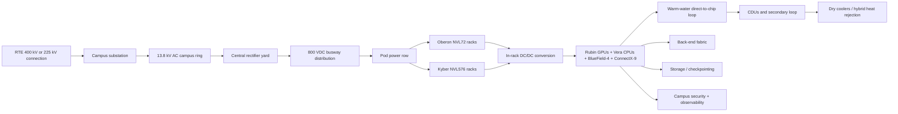
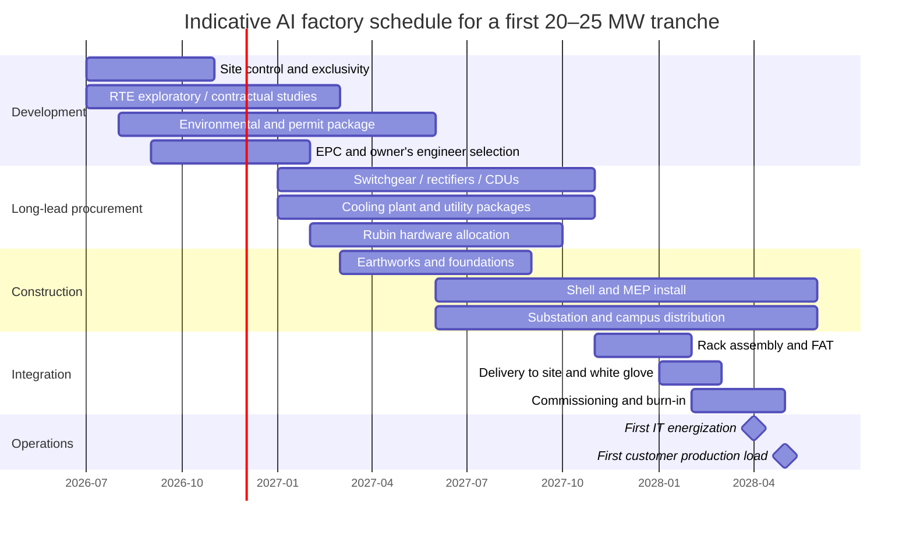

# French AI Factory Deep Research Report

## Executive summary

This report evaluates French sites that could host a **100 MW AI factory** or **modular 20–25 MW tranches**, and maps the supply chain needed to deliver a Vera Rubin–class deployment. On the evidence available publicly, the **highest-confidence development candidates** are **Le Bosquel ZAC** in the Somme and **Dunkerque ZGI** at the Grand Port Maritime de Dunkerque. Le Bosquel is one of the few sites for which RTE has publicly pre-reserved **1 GW** on the fast-track framework, with land immediately mobilizable and recent local selection of a large AI-campus developer. Dunkerque ZGI is compelling because the port authority has already launched a dedicated AMI for a **400–700 MW** data center/supercomputer on **21 hectares**, with a future **400 kV** post only about **3 km** away and a clear industrial-water and port-logistics story. Fouju, Escaudain, and the former EDF Montereau site are also real high-power options, but they are either already tied to named developers or subject to more visible competing claims on capacity. A deprecated automotive site such as the former **PSA/Stellantis Aulnay-sous-Bois** plant is best treated as a **modular 20–25 MW brownfield option**, not a publicly evidenced 100 MW fast-track site. citeturn7view0turn7view3turn11view0turn11view1turn15search9turn17search1turn19search3turn19search5

For the **delivery stack**, the strongest France/EU construction and MEP ecosystem includes **CAP INGELEC/INGENOVA**, **Equans**, **Eiffage Énergie Systèmes**, **Mercury**, **VINCI Energies**, **SPIE**, and **Exyte**. For liquid cooling and high-density AI halls, the most credible short list is **Schneider Electric**, **Vertiv**, and **CoolIT Systems**, with **Eaton** and NVIDIA’s broader 800 VDC ecosystem relevant on the power chain. NVIDIA has made clear that **800 VDC** is the architectural direction for **1 MW-class racks** and that full-scale production of **Kyber** systems aligns with **2027**, while Rubin rack-scale systems are supported by a broad ecosystem that includes **Eaton, Schneider Electric, Vertiv, Delta, Flex Power, LiteOn, Megmeet, and semiconductor/power-electronics partners**. citeturn28search0turn28search5turn28search10turn28search11turn29search0turn29search1turn30search0turn30search1turn30search2turn30search7turn30search8turn30search9turn42view1turn42view4

For **rack assembly**, the two most practical models are:  
**Europe-first assembly** with an ODM or integrator that can build in Europe and move complete racks to France by truck, such as **Wiwynn Brno** or other large European EMS footprints such as **Jabil**; and **Taiwan-first assembly** via **Wiwynn Taiwan** or **QCT/Quanta** in Taiwan with containerized ocean freight to Dunkerque/Le Havre/Rotterdam and secured final-mile to site. Wiwynn explicitly shows **Brno, Czech Republic** as a European manufacturing center and **Tainan, Taiwan** as an Asian manufacturing center; QCT identifies itself as a Taiwan-headquartered data-center hardware provider offering integrated rack systems. citeturn32view0turn32view1turn33search0turn33search1turn33search2

The **Rubin design recommendation** is to develop the campus as **repeatable 20–25 MW blocks** rather than chase a 100 MW single-date cutover. A sensible phasing plan is: start with **Oberon pods** built around **NVL72** racks, but make the electrical backbone **800 VDC-ready** from day one so later phases can accept **Kyber NVL576** domains without ripping out the power chain. NVIDIA states that 800 VDC is intended to support **100 kW to >1 MW** rack classes, improves end-to-end efficiency by **up to 5%**, can reduce maintenance cost by **up to 70%**, and is the foundation for **Kyber** in **2027**. That makes a staged “Oberon now, Kyber-ready from civil day one” plan the most robust industrialization path. citeturn42view1turn42view4

Economically, the cleanest way to think about the project is to separate **powered-shell infrastructure CapEx** from **IT hardware CapEx**. Turner & Townsend’s 2025–2026 index places **Paris** at about **US$10.8/W** for traditional data center construction and notes a **7–10% premium** for liquid-cooled AI facilities of similar IT capacity. That supports a rough powered-shell benchmark of roughly **€10–12/W** for an AI-ready French campus in strong secondary markets, before unusual site remediation or bespoke grid works. The Rubin hardware layer is much more volatile and less transparent. Public market reporting has placed **GB200 NVL72** at roughly **US$3 million** and Vera Rubin NVL72 systems materially above that, while SemiAnalysis has published a Rubin NVL72 bill-of-materials model. Because NVIDIA has not publicly published a standard street price for Rubin, all Rubin CapEx numbers in this report should be treated as **scenario ranges**, not quotations. citeturn39view0turn36search10turn36search9turn36news33turn36news34

My headline recommendation is therefore:

| Priority | Recommendation | Why |
|---|---|---|
| Best near-term site | **Dunkerque ZGI** | Best logistics, powerful official site package, port access, clear 400–700 MW frame, future 400 kV infrastructure nearby. citeturn11view0turn11view1turn22view1 |
| Best dedicated rural AI campus | **Le Bosquel ZAC** | RTE fast-track 1 GW site, 33 ha immediately mobilizable plus reserve land, explicit AI-campus trajectory. citeturn7view0turn7view2turn7view3turn26search1 |
| Best brownfield fallback | **Former PSA Aulnay** | Large artificialized estate and digital uses already emerging, but public evidence does **not** support treating it as a fast-track 100 MW site today. citeturn19search3turn19search5turn18search1 |
| Best deployment model | **20–25 MW repeatable tranches** | Matches grid realism, financing discipline, and Rubin supply uncertainty better than a single 100 MW cliff-edge build. citeturn42view1turn39view0 |

## Site selection and grid readiness

### Shortlist of French candidate sites

The table below focuses on sites with the strongest publicly visible evidence for either very large power delivery or credible modular expansion. Coordinates are **approximate site or commune centroids** where public AMIs do not publish parcel GPS; they are included for screening only.

| Site | Approx. coordinates | Land area | Current status and ownership | Grid situation | Permitting and environmental position | Estimated timing to first 100 MW |
|---|---|---:|---|---|---|---|
| **Le Bosquel ZAC** | ~49.74, 2.22 | **33 ha immediately mobilizable** plus **~17 ha** reserve | CC2SO AMI launched for a hyperscale campus; SoftBank/Sesterce JV announced as selected developer in June 2026. Exact final landholding structure not public. citeturn7view2turn7view3turn24view2turn26search1 | RTE has pre-reserved **1 GW** under fast-track for Le Bosquel; public AMI materials describe **240 MW in 24 months** and **1 GW in 4 years**, with extension potential beyond that. citeturn7view0turn26search1turn26search11 | Existing ZAC/public-inquiry history; official environmental review highlighted land-take, multimodal-access weakness, landscape/Barnier-amendment compatibility, and need to assess flood-risk-plan compatibility. citeturn24view0turn23search7 | **High confidence for 100 MW by ~2028–2029**, assuming final fast-track contract, permits, and EPC mobilization. This is an inference from the published 240 MW/24 months and 1 GW/4 years framework. citeturn26search1turn25search0 |
| **Dunkerque ZGI** | ~50.96, 2.18 | **21 ha firm**, with optional **10 ha** first-refusal block and possible 4 ha release later | Plot in the private domain of the Grand Port Maritime de Dunkerque; port-led AMI open for a data center or supercomputer. citeturn11view0turn12view3turn13view1 | Official AMI specifies a fast-track site for **400–700 MW**; RTE’s base scheme is a **double underground 400 kV link** to the **Flandre Maritime** substation under construction, about **3 km bird’s-eye** away. CRE has separately approved major reinforcement works in the Dunkerque area, including the future **Puythouck 400/225 kV** station and associated 400 kV links. citeturn22view1turn22view3turn11view1turn10search6 | GPMD says preventive archaeology and environmental authorizations for water law and protected species have already been carried out; autonomous wastewater treatment is still required on the parcel; industrial and potable water networks exist. citeturn22view1turn22view3 | **Best public case for 100 MW by ~2028–2029** and for later expansion toward 400–700 MW. First 20–25 MW tranche could likely come earlier than 100 MW if grid phasing is staged. citeturn22view1turn11view1 |
| **Parc des Soufflantes, Escaudain** | ~50.3332, 3.3443 | Public sources show **38 ha** with **12–16 ha** still available in the ready-to-use package | Former **Usinor** brownfield, France 2030 “site clé en main”; Data4 confirmed a new campus there in 2026, which materially reduces practical availability for a new entrant. citeturn15search0turn15search4turn15search9turn15search14 | RTE publicly pre-reserved **700 MW** for the site. citeturn15search3 | Brownfield industrial context is favorable for reindustrialization; timing now depends heavily on Data4’s campus phasing and remaining parcel availability. citeturn15search9turn15search14 | **Technically attractive, commercially difficult** for a new project unless pursued as a JV or residual parcel strategy. Public evidence is weaker for user-controlled 100 MW availability than for Bosquel or Dunkerque. citeturn15search3turn15search9 |
| **ZAC des Bordes, Fouju/Crisenoy** | ~48.5833, 2.7833 | **110 ha** total ZAC | RTE 700 MW fast-track site; the ZAC was historically not realized, and public reporting now ties the site to the Campus IA / MGX-Mistral project. citeturn16search0turn16search1turn16search2turn25search6 | Fast-track contract publicly announced for **240 MW by end-2027** and **700 MW before end-2029**, with design allowing later scale-up to **1.4 GW**. citeturn25search6turn26search4 | Major issue is that the site sits on highly productive agricultural land and has long-running environmental controversy. citeturn16search8turn16search6 | **Strong grid case, weak access case** for a new independent developer because a flagship AI project is already publicly attached. citeturn25search6turn16news31 |
| **Former EDF Montereau-Vallée-de-la-Seine thermal site** | ~48.3803, 2.8511 | Public parcel size not clearly published in the materials reviewed | Former EDF thermal site on the communes of Vernou-la-Celle-sur-Seine and La Grande-Paroisse; EDF and OpCore entered exclusive negotiations in late 2025 for a multi-hundred-MW data center. citeturn17search1turn17search0 | RTE publicly pre-reserved **700 MW** for the former EDF Montereau site. The site is historically energy-connected and retains operational gas turbines. citeturn17search6turn17search3 | Brownfield energy-site reuse is a permitting advantage, but the public evidence suggests the asset is already in a developer process with EDF/OpCore. citeturn17search1turn17search8 | **High technical quality, limited market access** unless partnering with EDF/OpCore or targeting an adjacent parcel/use case. citeturn17search1turn17search6 |
| **Former PSA Aulnay-sous-Bois site** | ~48.9633, 2.4831 | Historical site around **180 ha**; current economic program cites **184 ha** for activities | Former automotive plant, now Val Francilia / InnovVal redevelopment. EPFIF acquired **105 ha** on behalf of the city in 2017; the site is being repurposed for logistics, circular-economy industry, metro functions, and digital uses, including an existing data center. citeturn19search5turn19search3turn18search1 | No public RTE fast-track reservation identified in the sources reviewed. Existing digital use is encouraging, but the **specific HTB source/substation strategy is not public**. citeturn18search1turn19search3 | Large artificialized brownfield in Greater Paris, but urban redevelopment complexity and neighboring uses make it a harder 100 MW candidate. citeturn19search3turn18search1 | **Treat as a 20–25 MW modular option** pending a fresh RTE/Enedis study; **do not underwrite 100 MW** on public evidence alone. citeturn19search3turn21view1turn21view2 |

### What the grid evidence actually supports

RTE’s fast-track framework is the single most important public signal in this market. The sites RTE has publicly identified are characterized by **several dozen hectares** and **proximity to the 400 kV grid**, specifically so very high loads can be supplied quickly. That is why Bosquel, Dunkerque, Fouju, Escaudain, and Montereau sit in a different class from ordinary brownfields. For a screening process, I would therefore distinguish between **grid-validated site options** and **brownfield real-estate options that still need a transmission answer**. citeturn7view0turn25search0turn25search1

The practical implication is straightforward. If the objective is a **bankable 100 MW program**, the site must already have either a public fast-track path or an obviously adjacent large-scale industrial transmission reinforcement. On that standard, **Le Bosquel** and **Dunkerque ZGI** are the cleanest north-France options in the public domain. **Fouju** and **Montereau** are technically excellent but are much less open from a commercial-access perspective. **Escaudain** is an excellent brownfield but appears largely spoken for by Data4. **Aulnay** remains interesting for modular urban-edge deployment, but the public record does not let an investor credibly assume 100 MW. citeturn7view0turn11view0turn15search9turn17search1turn19search3

### Grid contacts to open first

For projects above typical distribution thresholds, the primary counterparty is **RTE** rather than Enedis. RTE’s official commercial contact for northern France is the **Lille commercial service** at **commercial-lille@rte-france.com**, with the Lomme office address published on the RTE services portal. For Île-de-France and Normandy, RTE publishes **commercial-idf-normandie@rte-france.com** as the regional service-commercial contact. Enedis remains relevant for site-adjacent distribution works, temporary construction power, and any hybrid distribution topology; Enedis routes regional contact through its official help/contact system. citeturn21view1turn21view2

### Site ranking for this specific program

If the goal is a **dedicated AI factory** with room for repeated 20–25 MW blocks, my ranking is:

| Rank | Site | Investment view |
|---|---|---|
| **Le Bosquel** | Best mix of land control, north-France location, published fast-track headroom, and AI-campus political momentum. Main risk is community acceptance and detailed environmental integration. citeturn7view0turn24view0turn24view2 |
| **Dunkerque ZGI** | Best industrial utility stack, best import/export logistics, and strongest fit for Taiwan-container or heavy-project logistics. Main risks are port-domain contracting complexity and synchronization with Dunkerque-area grid reinforcement. citeturn11view0turn11view1turn22view1 |
| **Aulnay brownfield** | Best deprecated automotive site for a modular urban-edge strategy, but not a fast-track 100 MW site on present public evidence. citeturn19search3turn19search5 |

## Delivery ecosystem and supply chain

### Datacenter construction and EPC ecosystem

The French and European contractor market is deep enough to deliver a 20–25 MW tranche without depending on any single player, but the most credible integrators are those with visible hyperscale, critical-infrastructure, or exascale references.

| Company | Best-fit role | Evidence |
|---|---|---|
| **CAP INGELEC / INGENOVA** | Front-end design, owner’s engineering, and turnkey data-center delivery in France | CAP INGELEC says it provides integrated design-and-build services for turnkey data centers through INGENOVA, a specialist datacenter subsidiary. citeturn28search0turn28search4 |
| **Equans** | MEP delivery, building systems, HV interfaces, maintenance | Equans states it covers the full value chain for data-center design, rapid construction, environmental control, energy efficiency, heat recovery, electrical connection, and maintenance. citeturn28search5turn28search13 |
| **Eiffage Énergie Systèmes** | Electrical, hydraulic cooling, prefabricated substations, high-intensity AI/HPC rooms | Eiffage built the “largest data center in France” reference it publicized in 2022 and was entrusted with the electrical equipment and hydraulic cooling of the **JUPITER** exascale data-center modules at Jülich. citeturn28search2turn28search10 |
| **Mercury** | Hyperscale EPC / E&I / mechanical main contractor | Mercury describes hyperscale data centers as one of its core sectors and continues to publicize new European data-center groundbreakings and deliveries. citeturn28search11turn28search3turn28search7 |
| **VINCI Energies** | Data-center build, modular deployment, execution, operation | VINCI Energies states that it supports hyperscalers, cloud providers, and developers with design, execution, maintenance, operation, and modular data-center solutions. citeturn29search0turn29search6 |
| **SPIE** | High/low voltage, facilities, transformer stations, France delivery footprint | SPIE has created a department dedicated to data-center performance in France and has long experience with high-voltage substations and data-center operations. citeturn29search1turn35search10turn35search14 |
| **Exyte** | EU specialist for high-tech advanced facilities including data centers | Exyte identifies data centers as a core growth market in Europe. citeturn29search2turn29search8 |

For a **100 MW French AI factory**, I would not use a single monolithic EPC structure at the outset. A more robust approach is: **one lead integrator for campus program management and phasing**, one **electrical/HV leader**, one **critical-cooling package leader**, and one **owner’s engineer** that stays independent of the installer. In practice, a strong split would be **CAP INGELEC or Mercury** as program/EPC lead, **Eiffage or Equans** as high-power mechanical/electrical package leader, and **SPIE or VINCI Energies** on substation/cabling/commissioning layers. This is a recommendation derived from the capabilities above. citeturn28search0turn28search5turn28search10turn28search11turn29search0turn29search1

### Cooling and the 800 VDC-ready power chain

NVIDIA’s public position is unambiguous: future AI factories will move to **800 VDC**, with **13.8 kV AC converted centrally to 800 VDC**, then row and rack distribution handled in DC, with **DC/DC conversion in the rack**. NVIDIA says the architecture is being built to support **1 MW racks and beyond**, improves end-to-end efficiency by **up to 5%**, and is intended to enter full-scale production in step with **Kyber** in **2027**. citeturn42view1turn42view4

That has two immediate consequences for vendor selection. First, **direct-to-chip liquid cooling is not optional** for Rubin/Kyber-class deployments; Schneider explicitly frames liquid cooling as necessary for the high-density AI future and has published liquid-cooling solutions for racks beyond **400 kW**. Second, the **facility electrical ecosystem** must be selected from vendors already signaling 800 VDC roadmaps. The strongest public fit today is:

| Layer | Preferred vendors | Why |
|---|---|---|
| Facility liquid cooling and AI power rooms | **Schneider Electric**, **Vertiv** | Schneider positions liquid cooling as a purpose-built AI solution and is actively publishing 800 VDC architecture guidance; Vertiv has publicly aligned its roadmap to NVIDIA’s 800 VDC architecture and says its 800 VDC portfolio is scheduled for **2H 2026**. citeturn30search1turn30search5turn30search9turn30search0turn30search8 |
| In-rack cold plates, CDUs, and NVIDIA-specific loops | **CoolIT Systems** | CoolIT states it is a member of the NVIDIA Partner Network and offers NVIDIA-targeted cold-plate loops, CDUs, and cold plates for AI servers including GB200-class systems. citeturn30search2turn30search6turn30search14 |
| 800 VDC power devices and protection chain | **Eaton**, **Schneider Electric**, **Vertiv**, plus NVIDIA’s ecosystem partners | NVIDIA’s own 800 VDC article names Eaton, Schneider Electric, Vertiv, Delta, Flex Power, LiteOn, Megmeet, Navitas, STMicroelectronics, Texas Instruments and others as featured ecosystem companies. Eaton separately published an 800 VDC architecture and a design built in support of NVIDIA’s announcement. citeturn42view1turn42view4turn30search7turn30search11 |

For this program, the best engineering choice is to build the first tranche with an **800 VDC-ready backbone**, even if some early **Oberon NVL72** rows use a transitional arrangement. That avoids locking the campus into a distribution architecture that becomes suboptimal just as Kyber-class racks arrive. This is an inference from the published NVIDIA roadmap and the relative immaturity of mass 800 VDC products in 2026. citeturn42view1turn30search0

### Rack assembly models

The rack-integration decision has become strategic because NVIDIA’s AI systems are getting more vertically integrated. The practical choice is less “who can bolt parts together” than “who can secure allocation, integrate the rack, validate it, and deliver it reliably at scale.”

| Model | Candidate providers | Advantages | Drawbacks |
|---|---|---|---|
| **Europe assembly + truck shipping** | **Wiwynn Brno** as the clearest public option; Jabil as a broader European EMS footprint | Wiwynn explicitly lists **Brno, Czech Republic** as a manufacturing center and offers **rack integration** services; trucking complete racks into northern France cuts ocean delay, customs friction, and final-mile handling risk. Jabil has a large European footprint that can support regional electronics manufacturing and logistics. citeturn32view0turn32view1 | Best for shortened time-to-site, easier rework, reduced marine-shock risk, and lower customs complexity for repeated tranches. | Depends on European integration-slot availability; Europe may not get the earliest allocation if initial Rubin volumes stay Asia-centered. |
| **Taiwan assembly + containers** | **Wiwynn Taiwan** or **QCT/Quanta** in Taiwan | Wiwynn lists **Tainan, Taiwan** as a manufacturing center; QCT is a Taiwan-headquartered global data-center hardware provider with integrated rack systems. This model aligns best with the historical ODM supply chain for hyperscale hardware. citeturn32view0turn33search0turn33search1turn33search2 | Potentially better access to earliest builds and closest tie to upstream component supply chains. | More customs work, more in-transit shock/vibration risk, longer lead time, and stronger need for white-glove final-mile handling. |

My recommendation is to contract **both** models from the start. Use **Europe-trucked racks** for the first French tranche once stable volume is achieved, but preserve a **Taiwan direct-import path** for early-access capacity or when Europe is slot-constrained. That dual-path supply chain is especially valuable when NVIDIA generation transitions are still ramping. This is a recommendation based on the manufacturing footprints above and on the project-critical nature of GPU allocation. citeturn32view0turn33search0turn34search10

### Cabling, substations, and logistics

The campus needs two separate but coordinated supply chains: one for **power cables, busways, substations, HV gear, and installation**, and one for **structured data cabling and active network handling**.

| Scope | Recommended providers |
|---|---|
| Power cables and integrated data-center electrical cable package | **Nexans** and **Prysmian** have purpose-made data-center cable offers and full data-center electrical cable portfolios. citeturn35search0turn35search4turn35search8turn35search13 |
| HV/MV/transformer-station installation | **SPIE**, **Equans**, **Eiffage**, **VINCI Energies**. SPIE and Equans both publicize high-voltage capability; Eiffage and VINCI bring critical-facility execution scale. citeturn35search2turn35search3turn35search6turn35search7turn28search10turn29search0 |
| Data center operations / high-security structured delivery and white glove | **DSV**, **Kuehne+Nagel**, **DHL**, **CEVA Logistics** all have public data-center or cloud-infrastructure logistics offerings. CEVA adds strong on-site project-logistics capability. citeturn34search0turn34search1turn34search2turn34search3turn34search7turn34search15 |

For **Le Bosquel**, trucking from Europe is acceptable and probably preferable. For **Dunkerque ZGI**, the port setting gives a real advantage to a Taiwan-container model, especially if several Kyber systems arrive close together and you want marine-warehouse-site choreography. citeturn11view0turn34search0turn34search3

## Rubin tranche design and industrialization

### What NVIDIA has publicly disclosed

NVIDIA’s official materials position **Vera Rubin NVL72** as a rack-scale system and **Rubin Ultra/Kyber** as the next step. NVIDIA also says full-scale production of **800 VDC data centers will coincide with Kyber rack-scale systems in 2027**. In the 800 VDC technical note, NVIDIA states that it showed an **800 V sidecar capable of powering 576 Rubin Ultra GPUs in a single Kyber rack**, and the company’s Rubin announcement describes **Rubin Ultra** as starting with **NVL144** and scaling to a **flagship NVL576** configuration. NVIDIA’s power article also explains the target facility topology: **13.8 kV AC** converted directly to **800 VDC** at the power-room perimeter, then distributed to the rows/racks with in-rack DC/DC conversion. citeturn42view1turn42view2turn42view4turn3view4turn4view0

NVIDIA has also disclosed the surrounding ecosystem. Its Vera Rubin page lists system builders and partners including **Cisco, Dell, Eviden, Foxconn, GIGABYTE, HPE, Inventec, Jabil, Lenovo, Pegatron, Quanta Cloud Technology, Supermicro, and Wiwynn**. The 800 VDC article lists the facility power ecosystem, including **Delta, Eaton, Flex Power, LiteOn, Megmeet, Schneider Electric, and Vertiv**. The implication is that buyers should think in terms of a **rack-and-campus ecosystem**, not just “NVIDIA hardware.” citeturn3view4turn42view1

### Practical tranche architecture

I recommend standardizing on a **5 MW pod** as the smallest repeatable datacenter building block and packaging those into **20–25 MW tranches**.

**Oberon option**  
Plan around **NVL72** racks in pods sized for operational simplicity rather than absolute density. Because NVIDIA has not publicly published a standard Rubin NVL72 rack power figure in the materials reviewed, the power-per-rack below is a **planning inference**.

- Planning assumption: **~250–350 kW per Oberon NVL72 rack** after full thermal and electrical auxiliaries, pending OEM-specific design.
- A **5 MW pod** therefore holds roughly **14–20 Oberon racks**.
- A **20 MW tranche** is **4 pods**; a **25 MW tranche** is **5 pods** plus N+1 mechanical/electrical reserve.
- Best use case: early deployment, faster learning curve, easier repair strategy, less dependency on immature 800 VDC productization.  
  citeturn42view1turn30search9

**Kyber option**  
Use a campus designed around **NVL576** domains as the second-wave build once the 800 VDC supply chain is available.

- Planning assumption: **~0.8–1.0 MW per Kyber NVL576 rack-scale unit**, based on NVIDIA’s explicit move to **1 MW-class racks** and its Kyber/800 VDC guidance.
- A **5 MW pod** therefore holds around **4–5 Kyber units**.
- A **20 MW tranche** is approximately **20 MW gross / 16–18 MW IT** after cooling and electrical overhead, equivalent to **16–20 Kyber units** depending on redundancy and actual rack power.
- Best use case: large training domains, maximum density, and the cleanest long-run TCO once 800 VDC is mature.  
  citeturn42view4turn30search1turn30search8

### High-level system architecture

This architecture matches NVIDIA’s public 800 VDC flow—from perimeter AC/DC conversion to 800 VDC distribution and rack-level DC/DC—and fits the liquid-cooling direction now being taken across AI halls. citeturn42view1turn30search9

### Sourcing and assembly timeline

The timing that matters most is not just rack assembly. It is the overlap of **grid**, **civil**, **long-lead electrical**, **cooling**, and **GPU allocation**.

| Workstream | Oberon NVL72 planning window | Kyber NVL576 planning window |
|---|---|---|
| NVIDIA platform availability | Rubin NVL72 is tied to the 2026 product wave in NVIDIA’s public roadmap. citeturn3view4 | Kyber/800 VDC is explicitly linked by NVIDIA to **2027**. citeturn42view1 |
| Long-lead electrical and cooling equipment | 9–15 months from purchase order is a prudent working assumption for rectifiers, switchgear, CDUs, and major heat-rejection plant. This is an execution estimate, not a published SLA. | Same, but at greater risk because 800 VDC products are newer and some portfolios are only scheduled for release in **2H 2026**. citeturn30search0 |
| Rack integration + FAT + shipping | 8–16 weeks once a full allocation slot is secured; shorter for repeat orders, longer for first-of-kind. This is an execution estimate. | 12–20 weeks is safer for first-of-kind 800 VDC/Kyber validation. This is an execution estimate informed by platform novelty. |
| Campus civil and MEP per tranche | 15–22 months for a well-prepared 20–25 MW block in France, depending on permitting and grid synchronization; this is consistent with the broader hyperscale EPC landscape, though not a statutory deadline. | Similar civil duration, but electrical commissioning risk is higher because 800 VDC integration is newer. |

The key management principle is that **the first 20–25 MW tranche should not wait for the full 100 MW hardware plan**. The right sequence is to lock the grid, permit the campus at full build-out, but finance and install the IT in stages that match customer demand and platform maturity. That is especially important because NVIDIA’s facility roadmap and the mass-market vendor roadmaps are converging, but they are not yet fully mature in 2026. citeturn42view1turn30search0

## Economics and financing

### CapEx and TCO framework

The most reliable public benchmark available for **base facility cost** is the Turner & Townsend data-center cost index. It places **Paris at US$10.8/W** and says AI liquid-cooled facilities have a **7–10% premium** over comparable air-cooled builds. Because Bosquel and Dunkerque are not Paris-central sites and because both provide cheaper powered land than prime Paris data-center submarkets, I treat **€10–12/W** as a reasonable **powered-shell benchmark range** for a secondary-market French AI campus with liquid cooling, before extraordinary remediation or unusually expensive grid-connection charges. This is a planning inference anchored by the Turner & Townsend benchmark, not a site-specific contractor quote. citeturn39view0

The **IT layer** is much less stable. Public non-official market reporting has placed **GB200 NVL72** at roughly **US$3 million**, while newer public reporting indicates **Vera Rubin NVL72** systems could be several million dollars higher. SemiAnalysis has also published a Rubin NVL72 system-level bill-of-materials model, which is useful for directionally checking component drivers even though it is not an official price book. On that basis, Rubin procurement should be budgeted using **broad ranges** and financed as its own asset class, not folded blindly into generic “data center capex.” citeturn36search10turn36search9turn36news33turn36news34

### Cost scenarios

The table below is deliberately expressed as a range, because Rubin pricing and rack power are not yet published in a fully standardized way by NVIDIA.

| Scenario | Powered shell and utilities | IT compute, fabric, storage, sparing | Total indicative CapEx |
|---|---:|---:|---:|
| **20 MW tranche** | **€200M–€260M** | **€450M–€700M** | **€650M–€960M** |
| **25 MW tranche** | **€250M–€330M** | **€550M–€850M** | **€800M–€1.18B** |
| **100 MW campus, phased** | **€1.0B–€1.3B** | **€2.2B–€3.6B** | **€3.2B–€4.9B** |

These scenarios are built from:  
a base facility cost near **€10–12/W**;  
a Rubin hardware layer inferred from public GB200 and Rubin market references;  
and a campus model where storage, networking, spares, and site integration are not free add-ons but real line items. citeturn39view0turn36search10turn36search9turn36news33turn36news34

For **OpEx**, the biggest driver is power. Eurostat’s latest official release shows non-household electricity prices continuing to decline at EU level in **2H 2025**, and RTE says French wholesale electricity remained relatively stable in 2025 thanks to the competitiveness of France’s low-carbon mix. For underwriting, I would therefore model **three delivered-power cases** instead of pretending to know the final tariff today:

| Power case | Delivered power price assumption | Annual power cost at 25 MW average draw | Annual power cost at 100 MW average draw |
|---|---:|---:|---:|
| Conservative | **€90/MWh** | **€19.7M** | **€78.8M** |
| Base | **€70/MWh** | **€15.3M** | **€61.3M** |
| Aggressive long-term contract case | **€50/MWh** | **€10.9M** | **€43.8M** |

The price cases above are **planning scenarios**, not market quotes. They are anchored directionally by Eurostat’s non-household data and RTE’s statement that France’s low-carbon mix remains competitive. citeturn40search0turn41view0

### Financing structures that fit this asset

There are three financing structures that fit the industrial reality of these campuses.

The first is a **powered-shell SPV**. In that structure, land, grid connection, substation, shell, heat rejection, water, and security go into an infrastructure vehicle funded with sponsor equity and senior debt. This is the right choice if the campus expects multiple customers or staggered IT populations. It avoids financing 100 MW of GPUs before demand is proven.

The second is an **IT assetco/opco split**. The GPU and network layer sits in an equipment-holding vehicle with shorter-duration debt, leases, or vendor finance, while the shell remains in a lower-risk infrastructure SPV. This better matches the much shorter economic cycle of accelerators versus shells and substations.

The third is a **tranche-by-tranche draw structure**. That is the most conservative and, in my view, the most fundable:  
land and grid are financed first;  
then each 20–25 MW block draws debt only when power milestones, major customer commitments, and hardware slots are secured.

A practical capital stack for a first French tranche would be:

| Layer | Suggested structure |
|---|---|
| Land and early development | Sponsor equity and local debt; hold until final grid offer and permits |
| Grid, utility yard, shell, cooling plant | Infrastructure debt plus equity in an SPV |
| Rubin hardware and top-of-rack/network/storage | Lease, vendor finance, or short/mid-tenor equipment debt |
| Expansion tranches | Draw only against new offtake, new allocation slots, and demonstrated commissioning success |

This financing section is a proposed structuring approach rather than a sourced market survey. It follows directly from the fact pattern established in the rest of this report: long-lived grid/shell assets and short-lived, volatile-price IT assets should not be financed the same way.

## Sample delivery plans

### Suggested site-specific delivery strategies

| Site | Recommended configuration | Why |
|---|---|---|
| **Le Bosquel** | Start with an **Oberon 20–25 MW tranche**, build the campus electrical backbone **800 VDC-ready**, and reserve adjacent land and utility corridors for later Kyber pods. | The published public position of **240 MW in 24 months** and **1 GW in 4 years** suits a staged tranching logic. Bosquel’s land package is big enough for pod replication. citeturn26search1turn7view2 |
| **Dunkerque ZGI** | Use a **Kyber-ready port campus** strategy with either Europe-trucked first racks or direct Taiwan container logistics, plus a larger thermal-water program from day one. | Dunkerque’s logistics and industrial utility context make it the best place to absorb heavier, denser rack-scale imports. The public AMI is explicitly framed for **400–700 MW** and details industrial-water access. citeturn11view0turn22view1 |
| **Former PSA Aulnay** | Only pursue as a **brownfield 20–25 MW urban tranche** with strong community integration, power study, and reuse of existing artificialized land. | Public source material supports the real-estate logic, but not a fast-track 100 MW transmission story. citeturn19search3turn19search5 |

### Indicative project timeline

This is not a statutory schedule. It is an execution model derived from the fast-track grid pathways, the current Rubin/Kyber roadmap, and typical critical-facility delivery sequencing. citeturn25search0turn26search1turn42view1

### Site-by-site sample plans

#### Le Bosquel ZAC

**Best-fit outcome:** a **phased rural AI campus** beginning with one 20–25 MW tranche.  
**Why it works:** public land package, explicit AI-campus trajectory, and RTE fast-track scale. citeturn7view0turn7view2turn7view3

**Recommended stack**
- Lead design/build: **CAP INGELEC** or **Mercury**. citeturn28search0turn28search11
- Electrical/HV/cooling package: **Eiffage Énergie Systèmes** plus **Schneider Electric** or **Vertiv**. citeturn28search10turn30search0turn30search1turn30search9
- Rack path: **Wiwynn Brno by truck** for repeated tranches; keep **Taiwan contingency** for early allocations. citeturn32view0turn33search0
- Power and network cabling: **Nexans + SPIE/Equans**. citeturn35search4turn35search2turn35search3
- Logistics: **DSV** or **Kuehne+Nagel** for Europe road and controlled final mile. citeturn34search0turn34search1

**Likely critical path**
1. confirm final land control and local integration package;  
2. secure the RTE fast-track contract and energization phasing;  
3. permit a full-build campus but finance only tranche one;  
4. populate tranche one with Oberon, leaving Kyber corridors and electrical topology ready from day one.  
This path is supported by Bosquel’s published power phasing and land position. citeturn26search1turn24view2

#### Dunkerque ZGI

Here the location is the differentiator. The port authority’s public package already describes the site as ready for a very large AI facility, with land in the port’s private domain, environmental/archaeology groundwork done, industrial water available, and a base RTE scheme to connect to a nearby 400 kV substation. That makes Dunkerque the best candidate if the supply chain will rely materially on containerized imports, oversized electrical modules, and industrial-water assisted cooling. citeturn11view0turn22view1turn22view3

**Recommended stack**
- Lead EPC: **Mercury** or **Exyte** for large, technically dense packages; **Eiffage** or **Equans** for the French electrical/mechanical package. citeturn28search11turn29search2turn28search10turn28search5
- Rack path: **Taiwan container route** via **Wiwynn Taiwan** or **QCT**, followed by secured port-handling and white-glove final mile. citeturn32view0turn33search0turn33search1
- Logistics: **CEVA** or **DHL** because both explicitly support data-center hardware logistics, and CEVA can also manage site operations. citeturn34search2turn34search3turn34search15

**Best phasing logic**
- tranche one: **20 MW Oberon** or a mixed Oberon/Kyber pilot depending on 2027 availability;  
- tranche two onward: switch to **Kyber-first** once 800 VDC products are commercially stable.  
That lets the site exploit its industrial edge without waiting for the entire 700 MW envelope. citeturn22view1turn42view1

#### Former PSA Aulnay-sous-Bois

Aulnay is the right place to be strict. The real-estate logic is excellent: very large artificialized automotive land, existing digital usage, logistics access, and an urban redevelopment program already oriented toward new technologies and economic activity. But the project should be modeled as a **special-situation brownfield tranche**, not as a public-visibility 100 MW powered-land play. citeturn19search3turn19search5turn18search1

**Recommended use**
- one **20 MW modular AI block** on the most isolated and already artificialized subparcel;
- high attention to acoustic, traffic, and urban-integration design;
- power study with **RTE/Enedis** before any underwriting assumption above a first tranche.

**Recommended stack**
- Design/build: **CAP INGELEC** or **VINCI Energies** with a strong urban-interface package. citeturn28search0turn29search0
- Cooling and power: **Schneider Electric** or **Vertiv**, prioritizing low-water and high-heat-reuse options. citeturn30search0turn30search1turn30search9
- Rack path: **European trucked racks** only, to reduce urban delivery complexity. citeturn32view0

## Open questions and recommended next steps

Several items remain materially **unknown in public sources** and must be closed before any investment committee decision:

| Open question | Why it matters |
|---|---|
| Exact parcel GPS and cadastral plan for Le Bosquel, plus final lease/ownership structure after the 2026 selection process | Needed for due diligence, permitting boundaries, and realistic road/access design |
| Exact RTE source-post / 400 kV approach details for Le Bosquel and Escaudain | Public RTE materials confirm capacity, but not all detailed interface points are public |
| Exact residual land availability and rights situation at Escaudain, Fouju, and Montereau | These sites appear technically strong but commercially partially spoken for |
| Verified Rubin rack power, OEM-specific cooling diagrams, and actual 2027 allocation terms | Needed to turn the Oberon/Kyber pod model into a procurement-grade engineering basis |
| Site-specific delivered power tariff, TURPE, and long-term contract structure | Needed to firm up Opex and debt sizing |
| Aulnay HTB feasibility and urban-acceptance envelope | Determines whether the deprecated automotive option is genuinely investable |

The recommended next steps are therefore tightly bounded:

1. **Open parallel RTE dialogues immediately** for **Le Bosquel** and **Dunkerque ZGI**, and request tranche-level energization phasing rather than only terminal capacity. Use the official RTE regional commercial contacts already published. citeturn21view1  
2. **Issue a non-binding EPC RFI** to **CAP INGELEC, Eiffage Énergie Systèmes, Equans, Mercury, VINCI Energies, and SPIE** for a standard **20 MW AI liquid-cooled block** with an **800 VDC-ready campus backbone**. citeturn28search0turn28search5turn28search10turn28search11turn29search0turn29search1  
3. **Run a dual rack-supply RFI**: one lane for **Europe assembly + truck** using **Wiwynn Brno**, one for **Taiwan assembly + container** using **Wiwynn Taiwan or QCT**. citeturn32view0turn33search0turn33search1  
4. **Freeze the campus standard** around a repeatable **5 MW pod**, so the project can scale from a first 20–25 MW tranche to 100 MW without redesigning civil works, utility corridors, or the DC backbone. This is the most financeable and least fragile route given current Rubin/Kyber timing. citeturn42view1turn39view0  
5. **Treat the Aulnay automotive brownfield as optionality, not core plan**, until a fresh RTE/Enedis feasibility package proves a credible first tranche. citeturn19search3turn21view1turn21view2

All source links are embedded in the citations throughout this report.