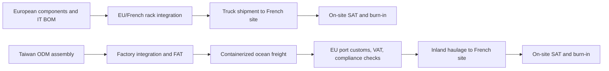
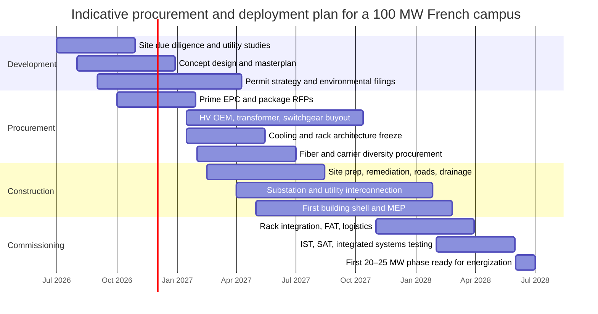

# Vendor Strategy for Building a 100 MW Compute Cluster at a French Brownfield Site

## Executive summary

A 100 MW compute cluster in France is now more a **power-and-delivery problem** than a pure real-estate problem. European supply is tight: JLL reports FLAP-D colocation vacancy at **6.3%** in Q4 2025, with **83% of pipeline pre-let**, and says contiguous space above **10 MW** is increasingly hard to secure; Turner & Townsend separately reports that the cost per watt of a traditional air-cooled cloud data center rose **5.5%** in 2025. In that environment, a brownfield self-build in France is strategically sensible if the chosen site can secure high-voltage utility access, permits, fiber diversity, and phased campus delivery. citeturn6view1turn5search8

For a French 100 MW campus, the strongest delivery pattern is a **French prime contractor-led consortium** plus specialist packages: a civil/MEP/HV prime, a cooling stack built around **hybrid direct-liquid cooling** for AI halls, a dual-source rack supply chain, and a separate owner-controlled package for network/fiber and commissioning. Based on the highest-confidence public evidence I found, the strongest overall prime candidates are **CAP INGELEC**, **Eiffage**, and **VINCI Energies/VINCI Construction**; the strongest electrical/HV delivery candidates are **Omexom**, **Eiffage Énergie Systèmes/Dorsalys**, and **Equans**; the strongest campus-network candidates are **SPIE ICS**, **Axians**, and **Equans Digital**. citeturn34search9turn34search8turn10search6turn10search2turn12search1turn12search2turn12search3turn26search20turn26search14turn26search1turn25search1turn25search0turn25search8

On cooling, the market signal is clear: Schneider Electric states that many AI servers with accelerators now **require liquid cooling**, and STULZ notes that direct liquid cooling is typically paired with residual air handling, with roughly **20%–30%** of heat managed by air in hybrid approaches. For a 100 MW French AI cluster, the default choice should therefore be **hybrid warm-water direct-to-chip** as the base case, with immersion reserved for a bounded pilot or a very specific high-density deployment where serviceability and ecosystem maturity have been fully derisked. citeturn6view2turn21search14turn24search14

Because the shared ChatGPT link with the previously identified French sites is **not available in this thread**, this report is site-agnostic and assumes a generic French brownfield profile: heavy industrial zoning, room for multi-building phased expansion, utility interconnection at MV/HV level, and the ability to create at least two diverse fiber entrances. Where site-specific matching would materially change the answer, I call that out explicitly.

## Assumptions and market context

I assessed vendors against a practical delivery target of **100 MW of compute load**, which in real projects usually implies a campus design with electrical and mechanical headroom above that figure, phased in blocks rather than energized all at once. Given European power scarcity and the difficulty of securing contiguous capacity, I recommend structuring the campus as **four or five phases of roughly 20–25 MW each**, even if the legal entity, permits, and masterplan are sized for the full 100 MW. JLL’s 2025 EMEA report supports this phased approach indirectly: it shows tighter vacancy, longer grid lead times, and a shift toward powered-land strategies and secondary markets. citeturn6view1

Public vendor pricing is thin. Across the official sources reviewed, almost none of the shortlisted vendors publish usable project rate cards for hyperscale campuses. In practice, commercial models are negotiated as **lump-sum EPC**, **GMP with open-book buyout**, or **package pricing per installed MW / per rack / per CDU / per meter of cable**. Schneider Electric’s reference-design material and Turner & Townsend’s cost-index commentary both reinforce that design choices, density, and cooling architecture now move budgets materially, particularly for AI-ready facilities. citeturn24search13turn5search8

For non-EU rack assembly imported from Taiwan, the key regulatory filters are not optional. Products placed on the EEA market must meet applicable **CE-marking** obligations; electrical and electronic equipment also falls under **RoHS**, and lifecycle obligations may engage **WEEE** rules. Importers and distributors in the EEA carry legal responsibilities for compliance, and imports from outside the EU also trigger ordinary customs and VAT procedures. CBAM is currently targeted at specified carbon-intensive goods; for finished servers, the main issue is usually not direct CBAM filing but upstream material/compliance transparency. citeturn29search0turn29search8turn29search16turn29search1turn30search0turn29search14turn29search6turn29search3turn29search7

## French construction and campus-delivery vendors

### Comparative table of French construction and turnkey-build vendors

| Vendor | HQ and French footprint | Public evidence of relevant experience | Certifications and standards visibility | Commercial / lead-time visibility | Assessment for a 100 MW French site | Sources |
|---|---|---|---|---|---|---|
| **CAP INGELEC** | HQ in **Mérignac**; dense French office network including Paris Charenton and multiple regional offices. | French turnkey engineering and construction specialist; says it is among the **top 3 French engineering companies** and has delivered **20,000+ turnkey missions**; explicit datacenter activity; references include **Telehouse Magny 2** and DATA4 work including HV connection works in Spain. | Dedicated certifications page; longstanding France Datacenter involvement. Public pages reviewed did not show Uptime/TIA company certification, but show structured quality/certification posture. | Negotiated turnkey design-build; no public rate card or lead time commitments. | **Very strong** as a datacenter-specialist prime. Best fit when you want a French-headquartered mission-critical specialist rather than a generalist GC. | Official sources: citeturn18search7turn18search11turn34search9turn34search0turn34search8turn34search11turn34search5turn34search6 |
| **Eiffage** | French group with dense territorial network across France and Europe. | 2025 revenue **€25.3bn**, **87,000 employees**; public datacenter references include the **Lisses hyperscale** project and DATA4 Marcoussis cooling works; in 2026 Eiffage was chosen for the **high-voltage substation and shared infrastructure** on Campus AI at Fouju in a contract worth **more than €120m**. | Strong general corporate and environmental/reporting frameworks; no public Uptime/TIA firmwide certification identified in reviewed pages. | Negotiated EPC / design-build / major-project contracting; hyperscale project postings indicate projects above **€100m**. | **Very strong** for a 100 MW brownfield where civil works, site infrastructure, and HV interface are as important as white-space delivery. | Official sources: citeturn11view0turn10search2turn10search1turn10search6turn10search12 |
| **Bouygues Construction** | HQ in **Guyancourt**; active in **50+ countries**. | Employs **35,600** people globally; positions itself directly on data centers; public data-center page cites a **Rated 3 hyperscale** project in the Philippines with **50 MW** IT power. | Project-level certification visibility exists via Rated 3 reference; no firmwide public TIA/Uptime certification found in reviewed pages. | Negotiated major-project contracting; no public lead-time or pricing disclosure. | **Strong** for large campuses and civil-engineering-heavy scopes, especially if paired with Bouygues-group energy expertise. Less French public hyperscale detail surfaced than for Eiffage or CAP. | Official sources: citeturn4search1turn20view0turn19search5turn19search1turn19search8 |
| **VINCI Energies / VINCI Construction** | French group; **2,200 business units** in **61 countries**; dedicated French units include **Cegelec Angers Data Center** and Omexom. | VINCI Energies reported almost **€20.4bn** revenue in 2024 and **109,000 employees**; dedicated data center vertical and energy/substation businesses within the same group. | Strong group governance and engineering depth; reviewed pages did not surface firmwide Uptime/TIA certification. | Usually best procured through multi-package VINCI entities rather than a single simple price sheet. | **Strong** where the owner wants one ecosystem spanning civil, electrical, cabling, telecom, and utility interconnection. | Official sources: citeturn14search1turn14search4turn12search2turn12search3turn12search6 |
| **SPIE Building Solutions / SPIE France** | Saint-Ouen-based French presence; group scale **55,000 employees**. | SPIE created a dedicated **data centre performance** department in France in 2026; strong data-center MEP references and long-standing Interxion work in Frankfurt including **FRA14** and **FRA16**. | Strong multi-technical reputation; no public Uptime/TIA corporate certification found in reviewed pages. | Typically MEP/technical-package or operating-services pricing, not public turnkey campus rates. | **Good** technically, especially for MEP, energy performance, and operations. Less convincing than top three as the sole civil-works prime for a 100 MW campus. | Official sources: citeturn17search3turn17search1turn17search2turn17search11turn17search5 |
| **GSE** | French general contractor with local offices across major French regions and Europe. | Publicly reports **640 employees**, including **401 engineers**, and **56+ projects a year**; has a datacenter product line but fewer large hyperscale public references surfaced than the larger French groups. | Strong ESG visibility; annual report shows **EcoVadis 89/100**. | Typical general-contractor negotiated pricing; no public hyperscale lead times found. | **Useful secondary bidder** where speed and design-build discipline matter, but I would not make GSE the only candidate for a first-of-kind 100 MW AI campus. | Official sources: citeturn16search3turn16search5turn16search2turn16search1 |

### Recommendation for the construction prime shortlist

My recommended construction shortlist is **CAP INGELEC**, **Eiffage**, and **VINCI Energies/VINCI Construction**. CAP INGELEC is the most focused datacenter specialist; Eiffage is the strongest French all-rounder on heavy infrastructure, HV, and brownfield transformation; VINCI is the most compelling integrated ecosystem if you want one family of contractors to cover utility interface, telecom, and technical packages as well as building works. Bouygues Construction is the strongest reserve option and should absolutely be invited if you want a fourth heavyweight bidder. citeturn34search9turn34search8turn10search6turn10search2turn12search2turn12search3

## Cooling architecture and cooling vendors

### Cooling strategy for a 100 MW French campus

For a 100 MW AI-oriented campus, I would not default to pure air cooling. Schneider Electric’s 2025 white paper says many AI servers with accelerators now require liquid cooling, and CoolIT, STULZ, and Schneider all argue that liquid architectures are the practical path once densities rise materially. STULZ also notes that in many direct-to-chip deployments, **20%–30%** of the thermal load remains with air, which is why the best real-world default is normally **hybrid air + direct-liquid cooling**, not “all liquid everywhere” on day one. citeturn6view2turn21search10turn21search14turn23search5

The working PUE ranges below are **my analytical benchmarking ranges**, not vendor guarantees. They are inferred from official sources showing that legacy air-cooled fleets still average around the mid-1.5 range, that new liquid-cooled architectures reduce cooling energy, and that operator case studies such as DATA4’s retrofit target significant PUE reduction. Use them for RFP benchmarking only. citeturn5search14turn22search6turn23search3turn22search16

| Cooling architecture | Best-fit density profile | Working benchmark PUE range for RFP use | Plant / white-space footprint | Heat-reuse potential | Evidence basis |
|---|---|---:|---|---|---|
| **Air-cooled with free cooling / chilled water** | Low-to-medium density CPU halls, network rooms, legacy x86 | **~1.20–1.35** for a new, well-designed European facility; higher for mixed legacy estates | Highest CRAH/CRAC and airflow footprint | Limited-to-moderate | Official sources: citeturn5search14turn24search12turn21search9turn22search12 |
| **Hybrid air + direct-to-chip** | Mixed campus with standard halls plus AI pods | **~1.10–1.25** | Lower air plant than pure air; some residual air remains | Good | Official sources: citeturn21search14turn24search14turn23search5turn22search6 |
| **Warm-water direct-to-chip** | Sustained high-density AI / HPC racks | **~1.08–1.20** | Lower mechanical footprint; strong rack-loop infrastructure need | Very good | Official sources: citeturn21search10turn22search14turn23search3turn23search5 |
| **Single-phase immersion** | Very high-density specialized pods, bounded zones, novel AI designs | **~1.05–1.15** | Lowest in-room airflow plant; tank/service footprint shifts elsewhere | Excellent | Official sources: citeturn21search5turn23search2turn23search6turn22search17 |

A French campus also has a meaningful opportunity on **heat reuse**. DATA4’s Paris-region work shows a live French example of server-heat valorization, while STULZ, Schneider Electric, and Submer all explicitly position liquid systems as better suited to heat reuse because of higher water temperatures and closer heat capture. citeturn23search0turn23search4turn23search12turn23search3turn23search5turn23search2

### Comparative table of cooling vendors

| Vendor | Solution coverage | France / EU footprint | Public evidence of capability | Commercial notes | Pros | Cons | Suitability for 100 MW France | Sources |
|---|---|---|---|---|---|---|---|---|
| **Schneider Electric** | Air, liquid, reference designs for AI, CDUs via Motivair integration. | French HQ in **Rueil-Malmaison**; deep French field presence. | Released end-to-end liquid cooling offer for high-density data centers in 2025; validated AI reference designs with NVIDIA; strong data-center cooling portfolio. | Enterprise negotiated package; typically priced as integrated Secure Power / cooling package, not public list pricing. | Strongest French OEM ecosystem; excellent for owner standardization and French stakeholder comfort. | Often needs a complementary rack-side specialist for the most aggressive compute designs. | **Top-tier.** Best one-stop French-adjacent cooling OEM. | Official sources: citeturn21search19turn21search25turn21search7turn24search7 |
| **Vertiv** | Broad air and liquid portfolio, room cooling through rack-level liquid support. | Strong EMEA presence including French-language product stack. | Publicly positions liquid cooling as core to HPC/AI transition; broad datacenter thermal portfolio in EMEA. | Package pricing; no public rate card. | Broad installed base, mature service model, good for hybrid deployments. | Less “French champion” positioning than Schneider. | **Top-tier.** Very strong for conventional-plus-AI campus thermal strategy. | Official sources: citeturn21search12turn24search6turn24search0turn21search18 |
| **STULZ** | Air, direct-to-chip, immersion-capable liquid infrastructure. | Europe-wide presence; French-language resources visible. | States that liquid cooling can lower PUE and improve heat reuse; notes hybrid designs where **20%–30%** of thermal load remains air-based. | Project-specific pricing only. | Strong technical credibility on hybrid thermal architecture. | Smaller ecosystem pull in France than Schneider/Vertiv. | **Very strong** specialist/OEM candidate. | Official sources: citeturn21search2turn21search14turn23search3turn24search10 |
| **Airedale by Modine** | Air-cooled chillers with free cooling, hybrid air/liquid, CDU products. | European manufacturing and support; strong UK/EU data-center activity. | Supplied CyrusOne’s European data centers; launched **1 MW CDU** manufactured in the US and Europe; positions free-cooling chillers as low-PUE options. | Equipment-package pricing; no public hyperscale rate card. | Strong for large-scale air/free-cooling and hybrid campuses. | Less complete end-to-end electrical/DCIM ecosystem than Schneider/Vertiv. | **Strong** if air/free-cooling remains important in early phases. | Official sources: citeturn21search3turn21search15turn21search27turn21search9 |
| **CoolIT Systems** | Direct-to-chip specialist: cold plates, CDUs, rack-loop infrastructure. | Global professional services; reviewed sources did not surface a French office. | Says top OEMs and ODMs integrate its cold plates; explicit direct-liquid-cooling and rack/CDU capabilities. | Usually sold via OEM/ODM or direct rack-loop package; no public price list. | Excellent for dense AI pods and rack-side thermal package. | Not the right sole facility-wide cooling prime for a 100 MW campus. | **Best as nominated DLC specialist** paired with Schneider/Vertiv/STULZ. | Official sources: citeturn21search10turn22search10turn22search14turn24search14 |
| **Submer** | Immersion, liquid-cooled modular/prefab infrastructure, design & build. | HQ in **Barcelona**, office in **Taipei**; EU-focused specialist. | Immersion-cooling specialist; offers datacenter design & build, modular products, and heat-reuse narratives; public EU collaborations include 2CRSi and Intel-linked reuse examples. | Project-based pricing; no public rate card. | Strongest immersion-specific specialist on this shortlist. | Service ecosystem and operational familiarity remain thinner than mainstream hybrid DLC in France. | **Best for an immersion pilot**, not my first choice as the default architecture for the full 100 MW campus. | Official sources: citeturn21search11turn24search3turn21search23turn23search2turn23search6turn21search17 |

### Recommendation for the cooling shortlist

My cooling shortlist is **Schneider Electric**, **Vertiv**, and **CoolIT Systems**—but with a caveat. Schneider or Vertiv should be the **facility-level thermal OEM/integrator**, while CoolIT should be treated as the **rack-side direct-liquid specialist** if your compute configuration requires cold-plate-heavy AI rows. If you want a purely European stack without a strong North American specialist, replace CoolIT with **STULZ**. If immersion is politically or technically interesting, run **Submer** as a separate pilot package rather than betting the whole 100 MW on it. citeturn21search19turn21search12turn21search10turn21search2turn24search3

## Rack assembly supply chains

### Option A with European assembly and truck shipping

| Vendor | Form and geography | Public evidence of capability | Lead-time / commercial visibility | Pros | Cons | Suitability | Sources |
|---|---|---|---|---|---|---|---|
| **Eviden** | French advanced-computing vendor with French footprint and European delivery. | Built the modular data center for the **JUPITER** exascale system and markets the BullSequana EX advanced-computing range. | Public lead times not disclosed; typically engineered-project procurement. | Strong sovereign/HPC fit, strong political acceptability in France. | Public pages surfaced more HPC-system expertise than generic hyperscale rack-integration detail. | **Very strong** for sovereign HPC/AI blocks and early flagship phases. | Official sources: citeturn31search0turn31search2turn31search7turn27search21 |
| **2CRSi** | French server designer/manufacturer; France-made rack products. | French designer/manufacturer for data center, HPC, and cloud; **OctoRack** is designed and made in France; offers rack servers as complete systems or barebones. | Public lead times not disclosed. | Best French custom-server/rack integrator on the list; useful for sovereignty and early pilot halls. | Scale relative to Taiwanese ODMs is lower. | **Very strong** for European-source racks, especially sovereign or custom phases. | Official sources: citeturn27search0turn27search10turn27search15turn27search20 |
| **Rittal** | German IT-infrastructure manufacturer; Europe-wide logistics. | Covers configuration, production, logistics, reworking on customer premises; offers racks through to configured data-center solutions. | Public lead times not disclosed; generally catalog plus project integration model. | Mature mechanical platform and European logistics; good for truck shipping to France. | Stronger on rack infrastructure than on populated compute-system integration. | **Strong** as the rack-and-integration chassis partner. | Official sources: citeturn27search2turn27search12turn27search17turn27search22 |
| **Legrand Data Center Solutions / Minkels** | French group with Dutch datacenter-solutions arm. | Custom rack & stack products; public case for **800 high-density racks in France** for Equinix France. | Public lead times not disclosed. | Strong France/EU footprint; good for cabinet, containment, and high-density colocation-style deployment. | Less evidence of full populated compute-rack integration than 2CRSi or ODMs. | **Strong** for cabinet/containment and rack-stack packages, often paired with a compute integrator. | Official sources: citeturn32search2turn32search6turn32search3turn32search14turn32search11 |
| **Schneider Electric** | Global OEM with strong French presence. | **Integrator Ready Racks** are designed for system integration and fast deployment; ISTA 3E tested and certified packaging/shock system. | No public lead times. | Strong if you want pre-integrated IT racks packaged for rapid delivery and controlled transport. | More infrastructure-oriented than server-ODM-oriented. | **Good** for standardized, pre-integrated rack packaging and deployment. | Official sources: citeturn32search10turn32search1turn32search4 |
| **nVent SCHROFF** | European rack/enclosure platform with liquid-cooling alliance path. | Server/network racks plus data-center cooling; strategic alliance with CoolIT for rack-level liquid-cooled enclosure solutions. | No public lead times. | Good mechanical platform for dense liquid-ready racks. | Less direct evidence of full populated rack-integration capacity at hyperscale scale. | **Useful specialist**, not my first-choice sole integrator. | Official sources: citeturn27search3turn27search13turn27search18turn27search23 |

### Option B with Taiwan assembly and container shipping

| Vendor | Product and integration profile | Export / EU-readiness signals | Lead-time / commercial visibility | Pros | Cons | Suitability | Sources |
|---|---|---|---|---|---|---|---|
| **QCT** | Hyperscale rack systems integrating server, storage, and network into single rack designs. | Global data-center provider with localized EU/German site and contact paths. | Public lead times not disclosed. | One of the strongest true hyperscale rack-scale options. | France-local service footprint is less explicit than with European vendors. | **Top-tier** Taiwan/ODM option. | Official sources: citeturn28search0turn28search6turn33search18turn33search0turn33search6 |
| **Wiwynn** | Explicit rack-integration business; 19-inch and 21-inch rack architectures; data-center operations optimization. | Says it has begun **in-region full-rack integration and shipment**; publishes a white paper on **liquid-cooling integration and logistics**. | No public lead times. | Excellent evidence base on rack integration, logistics, and AI/cloud delivery maturity. | French field support details were not explicit in reviewed pages. | **Top-tier** Taiwan option, especially for liquid-ready AI racks. | Official sources: citeturn28search1turn28search7turn28search13turn33search19turn28search18 |
| **Inventec** | Rack-scale AI systems including **Artemis** family with liquid-cooling options. | Strong AI-rack disclosures; supports rack-mounted/sidecar/row liquid options and self-developed CDU concepts. | No public lead times. | Strong on next-generation AI rack-scale designs. | European after-sales/service visibility weaker than top two. | **Top-tier** for high-density AI rack packages. | Official sources: citeturn28search3turn28search9turn28search19turn28search29turn33search8 |
| **Wistron** | Enterprise and networking systems; AI servers and general purpose server platforms. | Public enterprise-and-networking positioning with scalable, energy-efficient server products. | No public lead times. | Major ODM scale and manufacturing credibility. | Less public rack-system/logistics detail surfaced than QCT/Wiwynn/Inventec. | **Strong reserve option.** | Official sources: citeturn33search5turn33search23 |
| **Giga Computing / GIGABYTE** | Open Rack V3 building blocks, rack servers, AI infrastructure, EU support pages. | Dedicated EU enterprise site and support structure; 2025 revenue disclosed at group level on EU site. | No public lead times. | Strong EU commercial presence and broad portfolio. | Not as obviously a hyperscale ODM-integration specialist as QCT or Wiwynn. | **Strong reserve option.** | Official sources: citeturn28search5turn28search11turn28search26turn33search4turn33search10 |
| **MiTAC / TYAN** | Server platforms for AI/HPC/cloud/enterprise; TYAN support now merged with MiTAC support. | Public support and product continuity visible; long server-manufacturing heritage. | No public lead times. | Credible server OEM with broad platform support. | Least public evidence of large rack-scale shipment/logistics maturity in reviewed sources. | **Secondary option**, not first-wave shortlist. | Official sources: citeturn28search4turn28search20turn28search30 |

### Supply-chain recommendation

For a French 100 MW program, I would run a **dual supply chain**:

My recommended **Option A shortlist** is **Eviden**, **2CRSi**, and **Rittal**. My recommended **Option B shortlist** is **QCT**, **Wiwynn**, and **Inventec**. Use Option A for early halls, sovereign workloads, and time-sensitive deployment because truck shipping inside Europe reduces customs friction; use Option B for volume scaling once compliance, packaging, and receiving procedures are stabilized. CE-marking, RoHS, WEEE, importer responsibility, and EU customs/VAT processes should be explicit RFP gates for all non-EU suppliers. citeturn31search0turn27search0turn27search2turn28search0turn28search1turn28search3turn29search0turn29search16turn29search1turn30search0turn29search14turn29search6

## Electrical and network infrastructure vendors

### Comparative table of electrical and high-voltage contractors

| Vendor | Public role and footprint | Relevant evidence | Commercial notes | Pros | Cons | Suitability | Sources |
|---|---|---|---|---|---|---|---|
| **Omexom** | VINCI brand focused on power generation, transmission, substations, distribution, storage in **36 countries**. | Designs, builds, and operates AIS, GIS, and converter substations; digital-substation EPC capability; temporary power for data centers and industrial sites up to **several tens of MVA**. | Negotiated EPC / grid-package contracts. | Strongest contractor-style HV/substation specialist on this list. | Usually needs coordination with broader civil/MEP prime. | **Top-tier** for incoming power and substations. | Official sources: citeturn12search3turn26search20turn26search15turn26search5 |
| **Eiffage Énergie Systèmes / Dorsalys** | French multi-technical and HV contractor within Eiffage. | Fouju Campus AI HV substation and shared infrastructure; 225 kV to 400 kV connection substation for Dieppe-Le Tréport offshore wind; HVB substations and HV lines. | Major-project negotiated pricing. | Excellent French delivery credibility and field familiarity. | Best when paired with Eiffage construction ecosystem. | **Top-tier** for French brownfield HV scopes. | Official sources: citeturn26search14turn26search19turn26search9turn26search24turn26search4 |
| **Equans** | Bouygues-group energy integrator with datacenter and high-voltage capabilities. | Explicit high-voltage expertise; automation of substations; positions itself as an integrator rather than an exclusive-equipment vendor; claims 20+ years of data-center experience in Europe and worldwide. | Negotiated package pricing. | Good fit when owner wants one integrator across electrical, thermal, and digital. | Public France-specific hyperscale references were lighter than for Omexom/Eiffage. | **Strong** candidate for HV and on-site distribution packages. | Official sources: citeturn26search1turn26search11turn25search2turn25search20 |
| **SPIE** | French/European multi-technical services leader. | France data-center performance department; substation projects in France and Germany; broad electrical engineering capability around data centers. | Package pricing, usually project-specific. | Strong on technical equipment and lifecycle services. | Less pure-play HV/transmission identity than Omexom. | **Strong** as technical/electrical package contractor. | Official sources: citeturn17search1turn17search10turn17search12 |
| **Hitachi Energy France** | OEM plus systems integrator in substations and data-center electrification. | Says it can design, supply, and install the electrical system **from the grid substation to the miniature circuit breaker at the server**; has AIS/GIS/digital-substation offerings. | Usually procured as OEM/system supplier, not traditional civil prime. | Excellent OEM choice for GIS/AIS/digital substation packages. | Not the same thing as a French civil/HV contractor workforce. | **Best as named OEM / systems vendor** inside a broader EPC structure. | Official sources: citeturn26search2turn26search7turn26search12turn26search22turn26search27 |
| **GE Vernova Grid Solutions** | Grid OEM and systems supplier with strong French activity. | Grid Solutions portfolio; in France won the world’s first **245 kV SF6-free GIS** project for RTE. | OEM/package pricing. | Strong switchgear/GIS technology and French utility credibility. | Not a turnkey French brownfield contractor by itself. | **Best as named OEM** paired with an EPC/HV contractor. | Official sources: citeturn26search3turn26search8turn26search13turn26search23 |

### Comparative table of campus-network, fiber, and structured-cabling contractors

| Vendor | Public role and footprint | Relevant evidence | Commercial notes | Pros | Cons | Suitability | Sources |
|---|---|---|---|---|---|---|---|
| **SPIE ICS / SPIE Building Solutions** | French/European digital-infrastructure and data-center contractor. | SPIE explicitly lists **full cabling for bays and routers**, DCIM setup, and infrastructure design for data centers; France-specific data-center push in 2026. | Negotiated package pricing. | Best public evidence for actual mission-critical data-center cabling on this list. | Usually part of a broader technical package rather than a standalone trench-only contractor. | **Top-tier** for inside-plant and DCIM-linked campus cabling. | Official sources: citeturn25search1turn25search19turn25search25 |
| **Axians** | VINCI Energies ICT brand with France presence and telecom-infrastructure specialization. | Telecom-infrastructure and FTTx expertise; French roots and broad ICT infrastructure capability. | Framework/service + project pricing. | Strong for active/passive network integration and campus backbone design. | Less explicit public hyperscale structured-cabling reference than SPIE. | **Top-tier** for active/passive network backbone and integration. | Official sources: citeturn25search0turn25search6turn25search18turn25search12 |
| **Equans Digital / Equans Data Centers** | Bouygues-group digital, electrical, thermal, and datacenter integrator. | Says it covers the full value chain of data-center projects and highlights European data-center projects including Interxion Amsterdam. | Negotiated package pricing. | Strong multi-discipline fit where network, power, and cooling need one interface. | Public white-space structured-cabling specificity is less detailed than SPIE’s. | **Top-tier** for integrated campus packages. | Official sources: citeturn25search2turn25search8turn25search14turn25search26 |
| **Eiffage Énergie Systèmes / Dorsalys** | French infrastructure, telecom, and data-hosting markets. | States it supports energy, transport, telecom, and **data-hosting** infrastructure; datacenter references include electrical/HVAC work for Caelis. | Project pricing. | Good if same group already wins electrical package. | Stronger on infrastructure and MEP than best-in-class structured-cabling specialization. | **Strong** bundled option. | Official sources: citeturn25search17turn25search29turn25search11 |
| **Sogetrel** | French digital-infrastructure services group; “Connect-Integrate-Operate”. | Publicly positions itself as a specialist in digital infrastructures and connected equipment. | Project and service pricing. | Good national telecom-contractor footprint. | Reviewed public sources surfaced less datacenter-specific evidence than for SPIE/Axians/Equans. | **Useful reserve bidder**, especially for outside-plant and integration. | Official sources: citeturn25search15turn25search21 |
| **Circet France** | National telecom/fiber deployment specialist. | Strong fiber pre-wiring and national fiber-deployment capability; quality charter around fiber installations. | Service/project pricing. | Strong outside-plant and pre-fiber capability at national scale. | Weaker public evidence on mission-critical white-space cabling. | **Best for OSP and building-entry fiber**, not as sole white-space cabling prime. | Official sources: citeturn25search4turn25search16turn25search22turn25search28 |

### Recommendation for electrical and network shortlists

For **electrical/HV**, my shortlist is **Omexom**, **Eiffage Énergie Systèmes/Dorsalys**, and **Equans**. I would separately name **Hitachi Energy** and **GE Vernova** as preferred OEM/system suppliers for GIS/AIS/digital-substation packages rather than expecting them to act as sitewide French EPC primes. citeturn26search20turn26search14turn26search1turn26search2turn26search8

For **network/fiber**, my shortlist is **SPIE ICS**, **Axians**, and **Equans Digital**. If the selected site requires heavy outside-plant civil/fiber route work across public rights of way, add **Circet** as an OSP reserve, and specify that white-space structured cabling must be installed by the contractor’s manufacturer-certified crews against a named cabling standard. citeturn25search1turn25search0turn25search8turn25search4

## Recommended shortlist and procurement plan

### Recommended shortlist by category

| Category | Recommended shortlist | Why these three |
|---|---|---|
| **Construction prime** | **CAP INGELEC**, **Eiffage**, **VINCI Energies/VINCI Construction** | Best balance of French presence, datacenter credibility, and ability to coordinate civil + technical + utility interfaces. citeturn34search9turn10search6turn12search2 |
| **Cooling** | **Schneider Electric**, **Vertiv**, **CoolIT Systems** | Best practical combination of facility-scale OEM depth plus rack-side DLC expertise. citeturn21search19turn21search12turn21search10 |
| **Rack assembly in Europe** | **Eviden**, **2CRSi**, **Rittal** | Best mix of French sovereignty, custom integration, and European logistics/platform maturity. citeturn31search0turn27search0turn27search2 |
| **Rack assembly in Taiwan** | **QCT**, **Wiwynn**, **Inventec** | Strongest public evidence of rack-scale integration and AI/liquid-ready execution. citeturn28search0turn28search1turn28search3 |
| **Electrical / HV** | **Omexom**, **Eiffage Énergie Systèmes/Dorsalys**, **Equans** | Best French/EU contractor fit for substations, incoming power, and on-site distribution. citeturn26search20turn26search14turn26search1 |
| **Network / fiber** | **SPIE ICS**, **Axians**, **Equans Digital** | Best public evidence of data-center cabling, telecom infrastructure, and integrated campus delivery. citeturn25search1turn25search0turn25search8 |

### Procurement and deployment timeline

### RFP items that should be mandatory

The RFP should force every bidder to price and validate the **full campus masterplan**, not just the first hall. Require a phased plan showing how the campus reaches 100 MW without redesigning the utility entrance, substation topology, or fiber architecture. Ask for a full **critical-path schedule**, explicit long-lead equipment list, labor curve, commissioning method statement, and a named list of French and EU subcontractors. This matters because European availability is tight and pre-commitment is now the norm for meaningful capacity. citeturn6view1turn5search8

Require each cooling bidder to state the **percentage of heat captured by liquid**, water temperature window, maximum supported rack densities, residual air requirement, leak-detection philosophy, and heat-reuse interface conditions. Ask for a guaranteed **seasonal efficiency model**, not just nameplate performance. Liquid systems are now mainstream for AI, but the real differentiators are control philosophy, serviceability, and the owner’s ability to operate the plant over time. citeturn6view2turn21search14turn23search5

For rack suppliers, require disclosure of **factory integration steps**, burn-in duration, shock/transport validation, FRU sparing strategy, packaging method, customs/compliance document pack, and weekly output capacity once the line is ramped. For Taiwan-origin racks, require full responsibility matrices for CE, RoHS, WEEE, importer-of-record, VAT, and warranty returns into France. citeturn32search10turn33search19turn29search0turn29search16turn29search1turn30search0

For electrical contractors, require single-line diagrams from utility tie through to RPP/PDU level, relay and protection philosophy, short-circuit studies, substation footprint options, GIS versus AIS tradeoffs, black-start/temporary-power strategy, and transformer/switchgear manufacturing slots. For network contractors, require diverse-route designs, splice-loss budget, OTDR and certification methodology, structured-cabling class, containment/tray separation rules, and carrier meet-me-room handoff design. citeturn26search20turn26search2turn25search1turn25search6

### Site survey requirements before any vendor down-select

Before down-selecting any prime vendor, run a unified owner-led survey package covering **grid interconnection**, **geotechnics and contamination**, **planning/permitting**, **water and heat reuse**, **transport logistics**, and **fiber diversity**. If the site is a deprecated French factory or industrial parcel, brownfield issues can dominate program risk: contamination, demolition sequencing, buried services, legal easements, and historic electrical infrastructure can each blow up schedule and cost if not mapped early.

The utility survey should confirm the exact **interconnection voltage**, switching-yard boundary, protection requirements, fault levels, land needed for transformers/GIS, and whether the facility can be phased without stranded first-phase capex. The digital survey should map at least **two diverse fiber entrances**, carrier-neutral meet-me room options, and whether the route can support separate north/south or east/west terrestrial paths. The environmental survey should look specifically at flood risk, noise envelope, night-working restrictions, cooling-water constraints, and whether a viable **heat off-taker** exists within pipeable distance; liquid cooling makes reuse materially more attractive, but only if a real thermal sink is available. citeturn23search0turn23search4turn23search3turn23search5

## Open questions and limitations

The biggest limitation is that the **shared ChatGPT link containing the previously identified candidate sites was not available in this conversation**, so I could not map vendors to specific parcels, interconnection voltages, flood zones, or local carrier routes. That means the recommendations above are optimized for a generic French brownfield or ex-industrial site, not a parcel-by-parcel shortlist.

A second limitation is that **public vendor pricing and factory lead times are sparse** for hyperscale/AI infrastructure. Where reliable public figures were not available, I said so rather than inventing numbers. For the actual procurement, those unknowns should be converted into structured bidder commitments on manufacturing slot reservation, monthly output, FAT windows, and liquid-cooling integration readiness.

The last limitation is that some vendors—especially in the rack and network categories—publish strong portfolio language but comparatively few public France-specific hyperscale case studies. I treated those firms as viable where the technical evidence was strong, but I would insist on **reference checks, factory visits, and named-project CVs** before awarding any package.